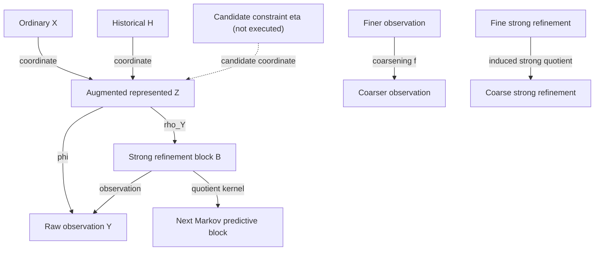
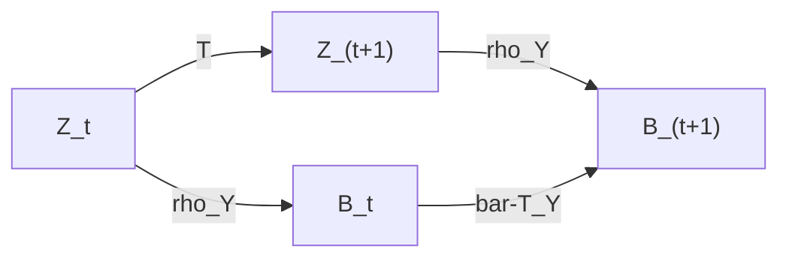
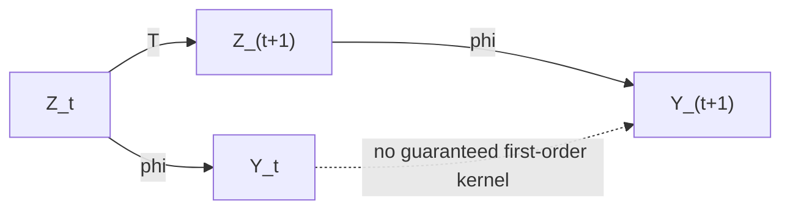
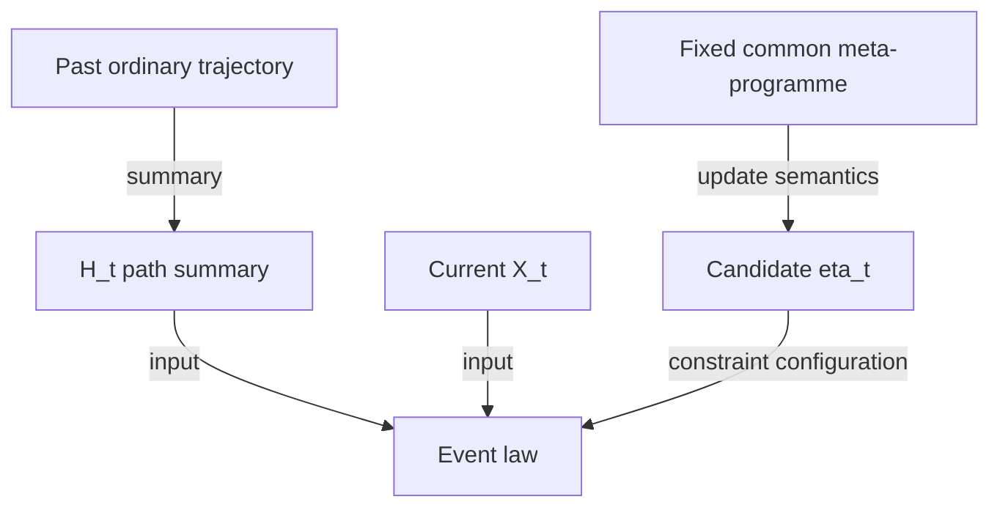

# State and quotient diagrams

Generated from synthesis.py. Coordinate/projection/input arrows describe
representation roles, not causal interventions. T arrows denote stochastic
kernels. H and eta are not presumed independent; eta is not executed.

## State Taxonomy

## Predictive Quotient Square

## Raw Observation Square

## History Constraint Roles

The quotient square asserts T D_rho = D_rho bar-T. The dotted raw
observation arrow does NOT assert the existence of a first-order kernel.
Coarsening of observations induces strong quotient maps by CL-T60/T61.
