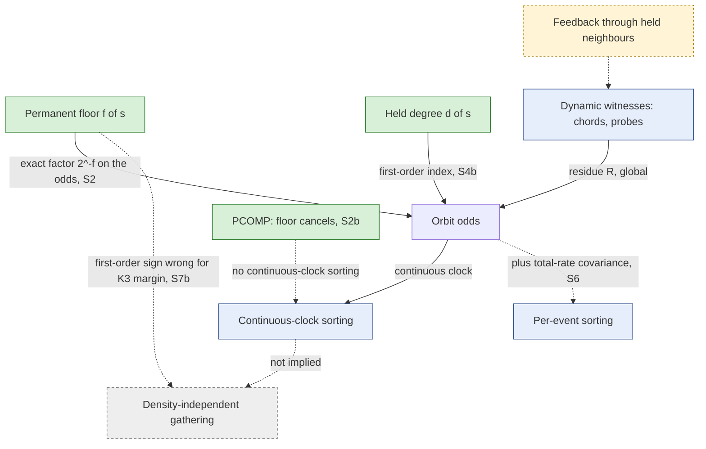

# How far does the witness floor explain sorting? A derivation (GT-P008)

*GT-P008, Workstream A, deliverable 2. Written 2026-10-15.*
- *Pure algebra plus post hoc views of the exposed E4 tables. No E4 or E5 cell was computed.*
- *Proof fixtures use synthetic factors on N=4 kernels (`constraint-lab/tests/test_gtsort.py`, 48 tests).*
- *Post hoc numbers come from `reports/gt-p008-secondary-analyses.json` (code `rs_constraint_lab.gtsort`), with definitions D1–D8 fixed in `docs/gt-p008-coverage-and-integrity-audit.md` before computing.*

**Labels used throughout:**
- **Theorem:** statement, assumptions and proof.
- **Verified identity:** checked numerically; named as such.
- **Observation:** an exact finite-model value from published laws.
- **Mechanism:** an explanation with its evidence and rivals.
- **Conjecture:** a general statement not proved.
- **Disproved / underdetermined:** a counterexample or an identifiability gap.

Layers: everything here is [M] or [O], with interpretation kept to §9 [RS].

## 0. The answer in brief

- **The floor is an exact local lever, not a sorting law.**
  - Under PATHF, PATHH and CSPH, an attachment's stationary *odds* factor exactly as 2^(−floor) × a residue (Theorem S2).
  - The residue depends on the whole stationary law, changes when the floor changes, and cannot be signed from local information (Theorem S3).
- **The floor accounts for most of the observed sorting, but not all of it.** At W4 strength the floor's exact factor makes up 71–100% of the continuous-clock log-odds contrast in P3 and the star. The remainder reinforces it in 8 of 9 contrasts; the ninth is ≈ 0.
- **At weak coupling the floor is not even the first-order determinant.**
  - The first-order sorting index is floor + (7 − N)·(held degree) for the path families (Theorem S4).
  - That index predicts the sign of all 16 within-reference continuous-clock contrasts in E4. But it also implies held graphs where the **higher-floor** site attracts more (Corollary S4c, 7 explicit cases).
  - So "lower floor ⇒ more attachment" is **false as a general law**.
- **Overall gathering margins are not first-order floor effects.**
  - K3 at N=5 has a strictly positive first-order margin slope for PATHF and PATHH, but negative published margins at W4 strength.
  - So the margin changes sign between weak and W4 strength (Corollary S7b). K3's stationary suppression is a finite-strength, global effect.
- **The two "equal-ratio" families (PATHF, PATHH) share their continuous law to first order** (Theorem S5). Their difference at P4, and everywhere else, is second-order. They sort by **opposite kinetic routes**: PATHF through faster formation, PATHH through longer lifetimes.

## 1. Setting and assumptions

- **(A1) Toggles.** A finite continuous-time chain on the free configurations of an O=2 pair graph on N labelled vertices, with single-pair toggles.
- **(A2) Rates.** Free slot e forms at rate F_e(x) > 0 and dissolves at rate D_e(x) > 0. Each is a product of factors e^(g·ε), one per satisfied witness instance, where g is the component grade (weak ±1, strong ±2). The published W4 cells have ε = ln 2.
- **(A3) Witnesses never read the slot itself**, so F_e and D_e do not depend on x_e (true of every path, closure and adjacency template).
- **(A4) Held reference.** Held slots have dissolution rate 0 and start present (`prohibit`). The chain lives on the 2^M free configurations, and under positive factors this class is irreducible. So the stationary law π is unique.
- **(A5) Label covariance and orbits.** Rules are label-covariant templates. Any permutation of the vertices that preserves the held graph H preserves the rates. So π is invariant, and all attachment slots in one source orbit have equal marginals.
- **(A6) Clocks.**
  - Continuous clock: π.
  - Per-event clock: ν = π·q / E_π[q], with q the total rate (`gte0a.stationary`).

Notation:
- e = (p, s) is an attachment slot: p a probe, s a source vertex.
- w_e is its path witnesses and t_e its closure witnesses.
- f(s) is the floor and d(s) = deg_H(s).
- T = 2(N−2)(N−3) is the number of ordered path templates, and K = |H|.

## 2. A1: the local structure, re-derived

**L1 (theorem: decomposition).** For an attachment e = (p, s), w_e(x) = f(s) + w_e^chord(x) + w_e^other(x), where:
- **f(s)** counts templates whose two relations are both held;
- **w^chord** counts templates whose three vertices lie in the source but which are not both held;
- **w^other** counts the rest.

f(s) is state-independent. The other two parts are state-dependent.

*Proof.* The three classes partition the ordered templates (`gte4a.witness_census` uses the same partition). Held relations are always present, so a both-held template is always satisfied. ∎

**F1 (re-derived): f(s) = Σ over held neighbours c of s of (deg_H(c) − 1).**
- *Proof.* A both-held template (end, c, d) cannot have end = p, because p has no held relation. So end = s, (s,c) ∈ H, and (c,d) ∈ H with d ∉ {s, p}. Since p has no held relation, the only exclusion is d ≠ s, which leaves deg_H(c) − 1 choices. ∎
- *Verified:* enumeration equals the formula for every connected held graph on 2–5 vertices at N = k+1, k+2 (`test_floor_formula_equals_enumeration_on_every_connected_held_graph`). The published `analytic_floor` agrees in all 8 scaffold-size combinations, and the published census `held_floor` matches to 1e-15.

**F2 (re-derived): among connected held graphs, the floor is zero everywhere only for K2.**
- *Proof.* A zero floor everywhere forces deg_H(c) = 1 for every held neighbour of every source vertex, that is, for every vertex of H. ∎
- *Verified* exhaustively on 2–5 vertices.

**L2 (theorem): closure witnesses of an attachment have no permanent part.** A closure witness of (p, s) needs (p, c) present, and p has no held relation. So the CSPH and CLOSEW formation factor 4^t or 2^t has no floor component. ∎

**How the floor enters each family (exact, from A2 and L1):**

| Family | F_e | D_e | Floor factor on the toggle |
| --- | --- | --- | --- |
| PATHF ws | 2^(−w) | 1 | formation × 2^(−f(s)): **suppresses** high-floor attachment |
| PATHH wf | 1 | 2^(w) | dissolution × 2^(f(s)): **shortens** high-floor attachment |
| CSPH | 4^(t) | 2^(w) | dissolution × 2^(f(s)) |
| PCOMP | 2^(w) | 2^(w) | both × 2^(f(s)): **cancels in the ratio** |
| CLOSEW, NULL | 2^(t) or 1 | 1 | none |

A path component with σ < 0 (not run in E4) would reverse the sign of the floor factor.

**F4, stated precisely (theorem; was E3 T8).**
- **What it says.** Constants c_e and d_e that multiply the formation and dissolution rates of specific slots change no **cycle affinity**: the log of the forward-over-reverse product around a closed cycle. Each slot is formed as often as it is dissolved, and reversal swaps the two.
- **What it does not say.** It says nothing about stationary occupancy, the jump law, one-step probabilities, event-order indices or current magnitudes.
- **Consequence.** "The floor is orientation-neutral" is true of affinities only (qualification Q-3).

**Level 1 (theorem: individual toggles).**
- Take the configuration x∅ in which every free slot is absent. There no chord and no one-held template is satisfied, so w_e(x∅) = f(s) exactly.
- So under PATHF, the formation rates of (p, s) and (p, s′) stand in the exact ratio 2^(f(s′) − f(s)).
- In any other state the ratio is 2^(f(s′) − f(s)) · 2^(w^dyn_(p,s′)(x) − w^dyn_(p,s)(x)). The dynamic difference can have either sign and can be as large as the dynamic template count.

**Level 2 (matched alternatives).**
- In the jump chain, the probability that the next event forms (p, s) rather than (p, s′) is the ratio of their rates. That is exactly the Level 1 ratio.
- So the floor biases the *competition* between matched formations by exactly 2^(−Δf), state by state, times a state-dependent factor. Toggle availability (the slot must be absent) is part of the state.

## 3. A2: from the local factor to stationary orbits

**S1 (theorem: stationary balance).** For every free slot e of any finite irreducible toggle chain satisfying (A1)–(A3):

  E_π[(1 − x_e) F_e] = E_π[x_e D_e],  so  occ_e/(1 − occ_e) = F̄_e / D̄_e,

with F̄_e = E_π[F_e | x_e = 0] and D̄_e = E_π[D_e | x_e = 1].

- *Proof.* Apply the generator to f(x) = x_e: (𝓛f)(x) = (1 − x_e)F_e(x) − x_e D_e(x). Stationarity gives E_π[𝓛f] = 0. Divide by P(x_e = 0) and P(x_e = 1). ∎
- *Verified:*
  - random state-dependent rates on 6 slots, to 1e-12 (`test_balance_identity_on_random_state_dependent_rates`);
  - on the published tables, the implied identities act = 2·occ (PATHF, where D ≡ 1) and act = 2(1 − occ) (PATHH, where F ≡ 1) hold to 2e-14 in every orbit of every cell.
- **It is a Level 3/4 bridge.** Exact, but the conditional means depend on π.

**S2 (theorem: exact floor factorisation of orbit odds).** For an attachment e = (p, s):

| Family | odds_e | Residue R_s |
| --- | --- | --- |
| PATHF | 2^(−f(s)) · R_s | E_π[2^(−w^dyn) \| x_e = 0] |
| PATHH | 2^(−f(s)) · R_s | 1 / E_π[2^(w^dyn) \| x_e = 1] |
| CSPH | 2^(−f(s)) · R_s | E_π[4^t \| x_e = 0] / E_π[2^(w^dyn) \| x_e = 1] |
| PCOMP | R_s = E[2^(w^dyn) \| 0] / E[2^(w^dyn) \| 1] | (floor cancels) |

Here w^dyn = w^chord + w^other.

- *Proof.* Substitute L1 into S1. The factor 2^(±f(s)) is constant, so it leaves the conditional mean. ∎
- **Consequence (exact):** for two orbits in one cell,

  Δ log odds = (f_H − f_L)·ln 2 + [log R_L − log R_H].

  The first term is the **floor term**; the bracket is the **residue**.
- **Caution.** This is an exact *accounting identity*, not a counterfactual attribution. Changing the floor would change π and therefore R.

**S2b (theorem: PCOMP has no continuous-clock sorting at any strength).** PCOMP's formation and dissolution rates are equal for every slot in every state. So π uniform satisfies detailed balance: π(x)·r(x → x ± e) = π(x ± e)·r(x ± e → x). Every orbit therefore has continuous-clock occupancy exactly ½ despite the floor. ∎
- *Verified:* published PCOMP orbits are 0.5 to 2e-14; the N=4 fixture is uniform to 1e-12 at ε = ln 2.
- **Disproves "a floor contrast implies continuous-clock sorting".**

**S3 (theorem: no local sign law).** Under PATHF, R_s ∈ [2^(−W_s), 1], where W_s is the largest dynamic witness count of the slot. Local information therefore guarantees "lower floor ⇒ higher odds" only if f_H − f_L > W_L.

- *Proof.* 2^(−w^dyn) ∈ [2^(−W_s), 1] pointwise. ∎
- At N=5 and 6, the non-floor templates of an attachment number 10–24, while the E4 floor gaps are 1–2. **No local argument can sign the orbit ordering.**
- The analogous bounds hold for PATHH and CSPH.

**Why the other standard methods fail here.**
- **Markov-chain tree theorem.** π(x) is a sum over spanning trees of rate products: exact, but global. No orbit inequality follows without controlling the whole tree sum.
- **Monotone coupling / FKG.** These need rates monotone in the configuration (attractive dynamics). PATHF formation *decreases* with the presence of other relations, which is repulsive. So no monotone coupling exists in general, and a counterexample to monotonicity is given in S4c.
- **Comparison bounds.** Through S3 they are too loose by an order of magnitude.

**What does work: perturbation around the uniform law.**

**S4 (theorem: first-order sorting).** Write every factor as e^(g·ε). Then, at ε = 0:

  d log odds_e / dε = Σ over formation components of g·E_0[witnesses] − Σ over dissolution components of g·E_0[witnesses],

where E_0 is the NULL product law: held relations present, free relations independent with probability ½. Per family:
- PATHF and PATHH: κ = −E_0[w_e];
- CSPH: κ = 2E_0[t_e] − E_0[w_e];
- CLOSEW: κ = E_0[t_e];
- PCOMP and NULL: κ = 0.

For an attachment (p, s) and a probe–probe slot (p, q):
- E_0[w_(p,s)] = T/4 + K + f(s)/4 + (N − 7)·d(s)/4;
- E_0[t_(p,s)] = (N − 2)/4 + d(s)/4;
- E_0[w_(p,q)] = T/4 + K.

*Proof.*
1. **π_ε is analytic in ε.** It is the unique stationary law of a finite irreducible chain with rates analytic in ε; by the tree theorem it is a rational function of the rates.
2. **Differentiate S1.** The ε-derivative of the conditional law multiplies the constant 1 at ε = 0, so only the derivative of the factor survives: d/dε E_(π_ε)[e^(gεw) | x_e = 0] at 0 = g·E_0[w | x_e = 0] = g·E_0[w]. The second step uses (A3) and independence under the product law.
3. **Count the templates of (p, s) by held relations.**
   - h2 = f(s).
   - h1 = 2·(2K) + d(s)(N − 5) − 2·S1(s), where S1(s) = Σ over held neighbours c of s of deg_H(c) = f(s) + d(s). The contributions are:
     - source-end with (s,c) held and (c,d) free: Σ (N − 2 − deg c);
     - source-end with (s,c) free and (c,d) held: Σ over c ∉ N[s] of deg c;
     - probe-end with (c,d) held: 2K − 2d(s).
   - h0 = T − h1 − h2.
   - Then E_0[w] = h2 + h1/2 + h0/4 = T/4 + (3/4)h2 + (1/4)h1, which simplifies to the stated form.
4. **Closure and probe–probe slots.** For closure, each c contributes ½·(1 if (s,c) is held, else ½). For a probe–probe slot, h2 = 0 and h1 = 2·2K. ∎

*Verified:*
- the closed form equals enumeration for every connected held graph on 2–5 vertices at N = k+1, k+2, k+3;
- the probe–probe and closure forms hold for all five presets;
- κ matches central finite differences (ε = 10^−4) on synthetic N=4 kernels for K2, P3, K3 and a two-edge star, in five families, to 1e-6;
- the published NULL witness means equal E_0[w] in every orbit, to 3e-15.

**S4b (corollary: the first-order sorting index).** For two source orbits L and H:

| Family | κ_L − κ_H |
| --- | --- |
| PATHF, PATHH | ¼[(f_H − f_L) + (7 − N)(d_L − d_H)] |
| CSPH | ¼[(f_H − f_L) + (9 − N)(d_L − d_H)] |
| CLOSEW | ¼(d_L − d_H) |
| PCOMP | 0 |

- **Held degree is the second channel.** At first order the floor is not the sole determinant: held degree enters at the same order, with a size-dependent coefficient.
- **Where (N − 7) comes from.** From step 3, h1 = 4K + (N − 7)·d(s) − 2f(s). Each held neighbour of s adds N − 5 one-held templates at the source end and removes two through S1 = f + d. So the degree term is negative below N = 7 and positive above, and the path families' degree term vanishes at N = 7. The expression is exact; it carries no further interpretation.
- **Closure (CSPH, CLOSEW) favours high held degree**, because held neighbours are potential common neighbours.

**S4c (corollary: first-order non-monotonicity in the floor; disproves a floor-only sign law).**
- **Construction.** Take N = 6 and the connected held graph G* with edges {01, 02, 03, 12, 14}.
  - Vertex 3 has floor 2 and degree 1.
  - Vertex 0 has floor 3 (its neighbours 1, 2, 3 have degrees 3, 2, 1) and degree 3.
  - Under PATHF or PATHH, κ_3 − κ_0 = ¼[(3 − 2) + 1·(1 − 3)] = −¼.
- **Consequence.** By analyticity, for all sufficiently small ε > 0, the **higher-floor** vertex 0 has the higher attachment occupancy. ∎
- **How common.** Among connected held graphs on ≤ 5 vertices at N = 6, 48 vertex pairs with different floors have a first-order index that disagrees with the floor order: 41 ties and 7 strict reversals (JSON field `first_order_monotonicity_counterexamples_n6`).
- **Underdetermined.** Whether any reversal survives at W4 strength (ε = ln 2) needs new cells. That is a proposal (next-round options, candidate B), not something run here.

**S5 (theorem: equal-ratio pairs share the first-order continuous law).**
- **Statement.** Around the uniform law (all base rates 1), the first-order stationary correction π_1 depends only on the first-order log rate ratios δ(log F_e − log D_e).
- *Proof.* First-order balance gives π_1·𝓛_0 = −π_0·δ𝓛. Since π_0 is uniform, (π_0·δ𝓛)(x) ∝ Σ_e (2x_e − 1)(δF_e − δD_e)(x), because inflow and outflow through each slot pair up. 𝓛_0 (independent unit-rate flips) is invertible on mean-zero functions. ∎
- **Corollary.**
  - PATHF ws and PATHH wf (δF − δD = −w in both) have the **same continuous law to first order**.
  - Every difference between them is second-order or higher: GT-F17's divergent laws, and P4's PATHF 0.067 against PATHH 0.255.
  - PCOMP (δF = δD) has π_1 = 0, consistent with S2b.
- *Verified* at N=4 for four scaffolds: the first-order laws agree to 1e-6 while each moves by more than 1e-3.

**S6 (theorem: per-event clock, first order).**
- **Statement.** d E_ν[x_e]/dε at 0 = κ_e/4 + Cov_0(x_e, q′)/M, where q′ = dq/dε at 0 and M is the number of free slots (at ε = 0, q ≡ M).
- *Proof.* Differentiate E_π[x_e q]/E_π[q] at the uniform law. ∎
- **Consequences.**
  - The clocks differ at **first** order. For PATHF, q′ = −Σ over absent f of w_f; for PATHH, q′ = +Σ over present f of w_f.
  - PCOMP: q′ ≠ 0 while κ = 0. So **the per-event clock sorts while the continuous clock cannot.** Published PCOMP per-event contrasts are +0.08 to +0.18 log odds.
- *Verified* against finite differences at N=4, to 1e-6.

**S7 (theorem: first-order slope of the overall raw margin, Level 6).**
- **Statement.** The published raw margin is E[attachments]/E[free relations] − r0 (continuous clock). Its slope at ε = 0 is (1/2M)[Σ over attachments of κ − r0·Σ over free slots of κ].
- *Proof.* Ratio of expectations with marginals ½ + κε/4. ∎
- *Verified* at N=4 (K2, PATHF), to 1e-6.

**Exact slopes:**

| Scaffold | PATHF / PATHH | CSPH |
| --- | --- | --- |
| K2 N=5 | 1/18 | 1/9 |
| K2 N=6 | 3/98 | 9/98 |
| P3 N=5 | 0 | −1/128 |
| P3 N=6 | 3/676 | 6/169 |
| K3 N=5 | 3/98 | 9/98 |
| K3 N=6 | 0 | 3/32 |
| S4 N=6 | 0 | −1/24 |
| P4 N=6 | −1/36 | −1/12 |

**S7b (corollary: the overall margin is not monotone in strength).**
- **Statement.** K3 N=5 under PATHF and PATHH, and P3 N=6 under PATHF, have strictly positive first-order slopes but negative published raw margins at ε = ln 2:
  - K3 N=5: −0.107 (PATHF) and −0.044 (PATHH);
  - P3 N=6: −0.039 (PATHF).

  Each margin is continuous in ε with value 0 at ε = 0, so it **changes sign in (0, ln 2)**. ∎
- **Scope.** This depends on the published values, which are exact to stationary residual ≤ 1e-12.
- **Consequence for K3.** The floor predicts K3's *local* suppression factor (¼ per attachment under PATHF at W4: two floor witnesses). It does **not** predict the stationary suppression: at first order K3 attachment is *favoured*. The published suppression is a finite-strength, global effect.

## 4. The priority contrasts, answered

All values are post hoc, from `gt-p008-secondary-analyses.json`, continuous clock unless stated. Δ is the log-odds contrast L − H; FO is the first-order prediction ln 2·(κ_L − κ_H).

| Contrast | Floor gap / degree gap | PATHF Δ (floor term + residue) | PATHH Δ | CSPH Δ | FO (PATHF = PATHH; CSPH) |
| --- | --- | --- | --- | --- | --- |
| P3 N=5, middle − ends | 1 / 1 | 0.840 (0.693 + 0.147) | 0.911 (0.693 + 0.218) | 0.690 (0.693 − 0.003) | 0.520; 0.866 |
| P3 N=6 | 1 / 1 | 0.859 (0.693 + 0.166) | 0.972 (0.693 + 0.279) | 0.865 (0.693 + 0.172) | 0.347; 0.693 |
| Star N=6, centre − leaves | 2 / 2 | 1.719 (1.386 + 0.333) | 1.862 (1.386 + 0.475) | 1.788 (1.386 + 0.402) | 0.693; 1.386 |
| P4 N=6, inner − ends | 0 / 1 | 0.067 (0 + 0.067) | 0.255 (0 + 0.255) | 0.558 (0 + 0.558) | 0.173; 0.520 |

- **P3.**
  - The middle's advantage is predicted in sign at first order, and the exact floor term carries 71–100% of it at W4.
  - With the chord present, both orbits have exactly two internal witnesses (Level 1). The middle's continuous-clock advantage then disappears or reverses: Δ = −0.25 (PATHF), −0.10 (PATHH), −0.02 (CSPH) at N=5. This is an association within a stratum, not a chord intervention (Q-2).
  - In the per-event clock, PATHH and CSPH keep a small positive Δ in that stratum (+0.18, +0.13): the sign depends on the clock.
- **Star.**
  - The floor gap is twice P3's and the observed Δ is twice P3's (1.72 against 0.86, PATHF N=6). But the held-degree gap also doubles.
  - **"A stronger floor contrast gives stronger sorting" is contingent:** at first order the index is floor + degree term, and S4c shows the floor alone can be outvoted.
- **P4: the necessary negative control.**
  - Equal floors, yet inner vertices out-attract ends under every σ > 0 family.
  - First order attributes this to **held degree** (inner 2, ends 1): ln 2/4 = 0.173 for PATHF and PATHH, and 0.520 for CSPH, whose closure term rewards held degree.
  - CSPH's observed 0.558 is close to first order. PATHF (0.067) and PATHH (0.255) straddle their common first-order value, as S5 requires: their split is second-order.
  - **In the per-event clock, PATHF reverses sign** (Δ = −0.053, against a first-order +0.058). This is the only per-event sign the first-order theory misses (19/20).
- **K2.**
  - Floor 0 everywhere, so no floor term, and its single orbit gives no within-reference contrast.
  - The raw margins are positive and match first order in sign (PATHF N=5: slope × ln 2 = +0.039 against observed +0.048).
  - The null-density-standardised margins are about 0 (+0.001, −0.023). A floor-free reference is **not sufficient** for density-independent gathering (GT-F62 stands).
- **K3.** S7b.

**First-order index against all published within-reference contrasts (post hoc):**
- the continuous-clock sign is right in **16/16**;
- the per-event sign is right in **19/20** (PCOMP adds four per-event contrasts);
- magnitudes are off by a factor of 0.36–2.8. First order under-predicts the one-sided path families (observed/predicted 1.5–2.8), except P4 PATHF (0.39). It over-predicts CLOSEW (0.36–0.52), and CSPH is within 0.8–1.3;
- at Level 6 the margin slope gets the raw-margin sign right in **22/26** nonzero cases. The four misses are K3 N=5 PATHF and PATHH, P3 N=6 PATHF, and P3 N=5 CLOSEW (+0.0004).

## 5. Kinetic routes and clocks (account P4)

From S1, with J = act/2: the present sojourn τ+ = occ/J and the absent sojourn τ− = (1 − occ)/J. These are exact stationary renewal means.

| Contrast (L/H ratios) | PATHF τ+ | PATHF τ− | PATHH τ+ | PATHH τ− | CSPH τ+ | CSPH τ− |
| --- | --- | --- | --- | --- | --- | --- |
| P3 N=5 | 1.000 | 0.432 | 2.487 | 1.000 | 2.064 | 1.035 |
| Star N=6 | 1.000 | 0.179 | 6.434 | 1.000 | 7.088 | 1.186 |
| P4 N=6 | 1.000 | 0.935 | 1.290 | 1.000 | 1.611 | 0.922 |

- **Two routes to the same ordering.**
  - **PATHF sorts entirely through formation.** Low-floor slots wait less while absent; lifetimes are identical, because D ≡ 1.
  - **PATHH sorts entirely through lifetime.** Low-floor attachments live longer; waiting times are identical, because F ≡ 1.
  - CSPH sorts mainly through lifetime. In P3 and the star its low-floor slots even wait slightly *longer* (τ− ratio 1.04, 1.19).
- **These identities are exact consequences of S1** given the rate forms. They show that "sorting" names a stationary pattern reachable by opposite kinetics.

**Clock summary:**

| Quantity | Effect of the floor |
| --- | --- |
| Cycle affinities | Unchanged (F4) |
| One-step probabilities | Exact factor 2^(−Δf) on matched formations, times a state-dependent factor (Levels 1–2) |
| Continuous-clock occupancy | Exact odds factor 2^(−f) times a global residue (S2); first-order index (S4) |
| Per-event occupancy | Differs from continuous at first order (S6); PCOMP sorts per event only |
| Event-order indices (handover) | Reweighted by occupancy; magnitude not predicted (F5) |

## 6. The residue: a mechanism, with rivals

**Observation.** At W4, the exact residue reinforces the floor in 8 of 9 P3 and star contrasts (+0.147 to +0.475; P3 N=5 CSPH −0.003). At first order the non-floor witnesses partly *offset* it: κ_L − κ_H = ¾ against Δf = 1 for P3 N=5, and 1 against 2 for the star. So the residue changes sign between weak and W4 strength.

**Mechanism: witness feedback through held neighbours.**
- A one-held template of a slot at s uses a held relation (s, c) plus a free relation at c, typically an attachment of c.
- If s is the low-floor site, its held neighbours c are high-floor sites whose attachments are rare. So s gains few such witnesses.
- Conversely, a high-floor site's held neighbour is the popular low-floor site, whose frequent attachments witness the high-floor site's slots.
- Popularity at one site thus *adds* suppression to its neighbours: a positive feedback.

**Evidence (unconditional witness means per slot, published census):**

| Contrast | NULL total, L / H | PATHF total, L / H | "Other" witnesses, NULL → PATHF (L / H) |
| --- | --- | --- | --- |
| P3 N=5 | 4.00 / 4.75 | 1.27 / 2.50 | 3.00 / 3.25 → 0.69 / 1.21 |
| Star N=6 | 8.25 / 9.25 | 1.02 / 3.79 | 5.25 / 5.75 → 0.48 / 1.60 |
| P4 N=6 | 8.75 / 9.00 | 2.85 / 3.02 | 5.50 / 5.75 → 0.94 / 1.11 |

- The witness gap between orbits **widens** from NULL to PATHF in P3 (0.75 → 1.23) and in the star (1.00 → 2.77), where held neighbours are heterogeneous.
- It does **not** widen in P4 (0.25 → 0.17), where every source vertex's neighbours are alike.

**Rivals not excluded:**
- The chord channel: chords are suppressed under PATHF and PATHH, removing a witness source that favoured the ends.
- Kinetic competition among a probe's slots.
- Plain nonlinearity of 2^(−w) (Jensen).

The census means are unconditional, while R conditions on absence or presence, so this is **consistent with** the mechanism, not proof of it.

**Conjectures (not proved; falsifiable):**
- **C1.** In connected held references, the exact residue has the sign of the floor term at W4 strength whenever held-neighbour floors are heterogeneous. *Would fail:* any such cell with an opposing residue.
- **C2.** For one-sided path families at W4, the first-order sorting index predicts the continuous-clock sign of within-reference contrasts. *Would fail:* a W4 cell on G* (S4c), or any reversal case, in which the floor order wins against the index.

## 7. Status of every claim

| Claim | Status |
| --- | --- |
| L1, F1, F2, L2; Levels 1–2 | **Theorem** |
| F4: affinities unchanged; occupancy not covered | **Theorem** (scope restated) |
| S1 stationary balance; S2 exact floor factor in the odds | **Theorem**; verified on the published tables to 2e-14 |
| S2b PCOMP: no continuous-clock sorting at any strength | **Theorem** |
| S3 no local sign law at E4 sizes | **Theorem** (bound) |
| S4 first-order coefficients and closed forms; S4b index | **Theorem**; verified |
| S4c higher-floor site favoured at weak coupling on G* | **Theorem** (counterexample, weak coupling) |
| S5 equal-ratio pairs share the first-order continuous law | **Theorem**; verified at N=4 |
| S6 per-event clock first order | **Theorem**; verified at N=4 |
| S7 margin slope; S7b sign change in (0, ln 2) for K3 N=5 and P3 N=6 | **Theorem** (S7b uses published values) |
| Floor term 71–100% of the P3/star contrasts at W4; residue reinforcing in 8/9 | **Observation** (post hoc accounting; not counterfactual) |
| First-order index gives the sign of 16/16 continuous and 19/20 per-event contrasts | **Observation** (post hoc) |
| Witness feedback through held neighbours | **Mechanism** (consistent evidence; rivals open) |
| C1, C2 | **Conjecture** |
| "Lower floor ⇒ more attachment" as a general law | **Disproved** at weak coupling (S4c); at W4 **underdetermined** |
| "A floor contrast implies continuous-clock sorting" | **Disproved** (PCOMP, S2b) |
| "The floor explains K3's stationary suppression" | **Disproved** as a first-order consequence (S7b); finite-strength mechanism **unknown** |
| "Within-cell orbit contrasts identify the floor's effect" (E4 F6) | **Qualified** (audit Q-1): matched observation; degree and dynamic witnesses vary too |

## 8. What remains unresolved

1. **No finite-strength theorem.** Nothing signs or bounds an orbit contrast at ε = ln 2 beyond S3's loose bound. Second-order terms (which separate PATHF from PATHH) were not derived.
2. **The residue mechanism is observational.** A test would need conditional witness laws, which are not in the published tables (they record unconditional means), or new cells.
3. **The per-event first-order theory misses P4 PATHF's sign**, and nothing explains it beyond "second order".
4. **Overall margins.** No theory below finite strength explains K3's or the star's raw margins. Composition (GT-F62) remains the best description, and the N=6 overlap limits apply (18–31% of the null weight on low-mass strata).
5. **Strata are partial.** Chord-conditioned tables cover P3 fully, but the star and P4 only for their first chord.
6. **Reversal cases (S4c) are untested** at W4 strength.
7. **The algebra stops at N ≤ 6** for published comparisons. The formulas hold for all N, but no N=7 law exists here.

## 9. Interpretation, kept separate [RS]

- In this grammar, a structure's internal support acts on new relations at three levels:
  - as an exact multiplicative lever on each attachment's odds;
  - as a degree-dependent tilt of the witness environment;
  - through feedback, in which a site's popularity burdens its neighbours.
- "Support makes a site less available" (OP-16) survives as the description of the lever. It is not a general law: the lever can be outvoted (S4c) or cancelled (PCOMP).
- None of this is attraction, force or motion. [P] none. [T] none.

