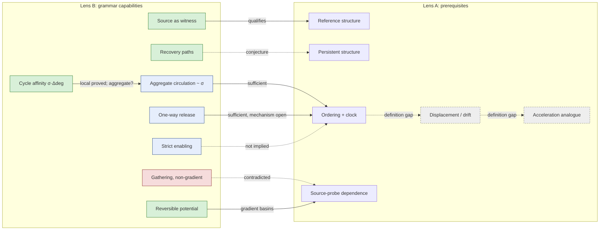
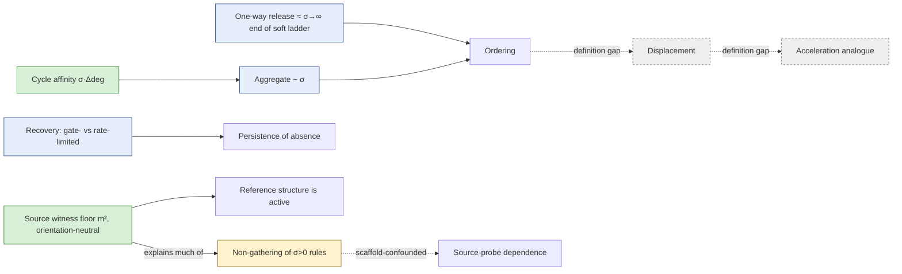
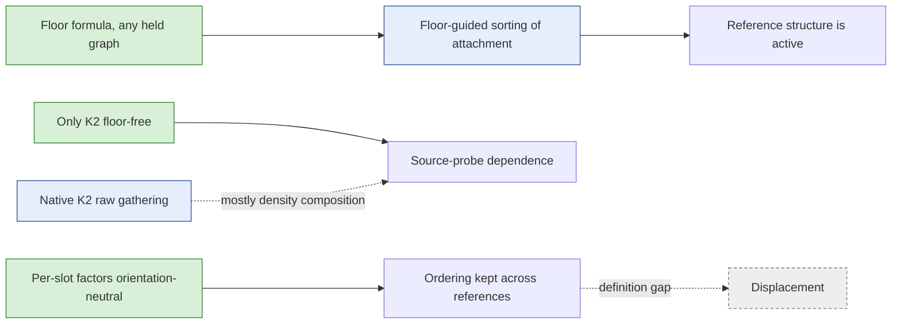
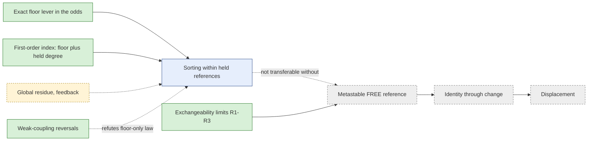
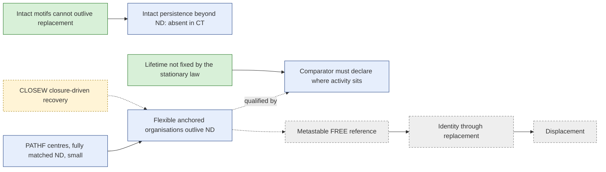
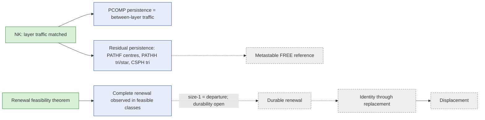

# GT foundational bridge map (dual lens)

*Prompt GT-P006, deliverable 2. **Baseline, written before E3A** (sections 1–7). Post-round revisions are appended as new sections and never edit the baseline. The baseline is also preserved by commit history.*

**Purpose.** This map orients the work and records gaps. It is not a theory of gravity, and it is not a list of stages to complete. It is a partial-dependency graph in which links may branch, offer alternative routes, stay uncertain, or be blocked.

**Lenses.**
- **Lens A (ontological depth)** asks what might need to exist between "stochastic relational actualisation under constraints" and gravity-, time-, space- or motion-like phenomena.
- **Lens B (mathematical possibility)** asks what the specified rules can generate, without naming it in the primitives.

The substrate picture is a motivating ontological proposal, not an established physical substrate. The two lenses inform each other, but neither validates the other's physical reading.

**Layers.** [O] model observation; [M] formal mathematics; [RS] ontological interpretation; [P] physical comparison; [T] theological or worldview premise.

## 1. Operational glossary (deliberately non-equivalent terms)

| Term | Model-operational definition, or "not yet defined" |
| --- | --- |
| Event order | The sequence of single-relation toggles on the jump chain. Patterns are consecutive pairs (`gtobs.event_order`) |
| Time parameter | **Not yet defined** as a physical time. The model has two declared clocks (below) |
| Jump clock | The count of events. A step index; not physical time |
| Continuous-time clock | Event weights read as rates; holding time in x is exponential with mean 1/R(x). A modelling convention, not physical duration |
| Current | Net stationary probability flux on a transition, π(x)W(x,e) − π(x⊕e)W(x⊕e,e) |
| Drift | The mean change of a declared state function per event or per unit time. Defined only once the function is named. GT has used radial drift of graph distance to the held source (G0/E0) |
| Distance | Graph shortest-path length in the current relation graph. An observable, not a metric primitive; no rule reads it |
| Displacement | **Not yet defined.** It would need an identity for "what moves" (an entity, a motif or a reference) and a frame relative to which it moves |
| Persistence | The holding time (or autocorrelation time) of a declared indicator: a relation, an absence, a motif, a hub |
| Recoverability | Whether, and how quickly, a released relation can be re-formed: gate distance, recovery probability within H events, expected recovery time (E3A) |
| Irreversibility | Positive irreversible flux; or one-way transitions (asymmetric support). These are distinct (formal note §3) |
| Attraction | **Not defined beyond the model:** in GT, a time-weighted attachment preference to a held source above a declared null (margins, four forms) |
| Acceleration | **Not yet defined.** It would need a non-circular position or separation observable, a clock, and a change of drift under declared controls ("relational acceleration analogue"). Not an E3 target |
| Metric | **Not yet defined.** Graph distance is not shown to satisfy any physical metric property beyond graph-metric axioms |
| Source | The HELD scaffold: three entities whose relations cannot dissolve |
| Scaffold | Anything imposed and declared: the held source, labelled entities, finite N, the choice of clock |

**Non-equivalences.**
- A preferred orientation of a four-event loop is not drift in position.
- A nonzero drift is not acceleration.
- A directed succession is one model capability; it is not physical time, gravity or curvature.

## 2. Top-down view: phenomena → candidate prerequisites (inquiry nodes, not requirements)

| Node | Status |
| --- | --- |
| P1 Identifiable reference structures | HELD imposes one. FREE hubs: not observed to persist (E-CENTRE not observed at N ≤ 6) |
| P2 Neighbourhood / relational separation | Graph distance exists as an observable. Its meaning as separation is **not defined** |
| P3 Local transition coupling | Constructed: witness-reading templates (closure, adjacency, path) |
| P4 Persistent structure | Partly: relations and absences have holding times; persistent identity of a moving thing is **not defined** |
| P5 Repeatable ordering and a specified clock | Ordering: constructed (handover, σ-oriented circulation, one-way release). Clocks: two declared conventions; no physical clock |
| P6 Displacement, drift or motion | Drift of graph distance to a held source: measured. Motion of an identified object: **not defined** |
| P7 Change of drift (acceleration analogue) | **Not defined** |
| P8 Source–probe dependence | Measured as attachment margins: fragile, and lost at N=7 for CSPH (GT-F36) |
| P9 Mutual interaction | **Not addressed** (no two-source or two-body construction) |
| P10 Scaling / coarse-graining | N=5–7 only; no coarse-graining defined |
| P11 Stable observable regularities | Some: the square identity (proved); σ-sign aggregate (36/36, empirical) |
| P12 Units and empirical calibration | **None.** No [P] comparison has been made |

## 3. Bottom-up view: grammar → mathematical behaviours

| Node | Status and evidence |
| --- | --- |
| B1 Reversible potential / occupancy (gradient rules) | [M] proved: GT-F12, G0 |
| B2 Kinetics independent of occupancy | [O]: G1, GT-F19 |
| B3 Non-gradient cycle affinity, A = σ·Δdeg | [M] proved: GT-F45 |
| B4 Aggregate oriented circulation following σ | [O] 36/36: GT-F46. No proof (GT-Q12) |
| B5 Local counter-circulation | [O]: GT-F48 |
| B6 Hard admissibility / strict enabling | [O]: GT-F50 |
| B7 Opportunity (denominator) ordering | [O]: GT-F49 |
| B8 One-way transitions (asymmetric support) | [O]: GT-F51; [M] support theorems (E3 formal note T1–T5) |
| B9 Recovery and return paths | [M] T3–T4 (always possible under HPF; shortest route = hitting set + 1). Kinetics unmeasured |
| B10 Source as witness | [M]: GT-F53 |
| B11 Clock-dependent occupation | [O]: GT-F34, GT-F40 |
| B12 Gathering in non-gradient families | [O] **absent/fragile**: GT-F36, GT-F18, E2 attachment below null |
| B13 Absorption / arrest | [O]: hard dissolution prohibition (E2) |

## 4. Links (baseline)

| From → to | Type | Model domain | Evidence | Missing step | Discriminator | Confidence / fragility |
| --- | --- | --- | --- | --- | --- | --- |
| B3 → B4 | Conditional implication? (empirical) | Positive-factor pair grammar, N=4–6, both modes | GT-F45, GT-F46 | An aggregate theorem, or a counterexample | Partner-index sign over a factor grid (E3A scan) | Local: proved. Aggregate: 36/36, with 6–36% counter-circulation |
| B4 → P5 (ordering) | Sufficient construction | As B4 | GT-F37, GT-F46 | None for "an ordering exists" | — | Robust within tested families; sign set by σ |
| B8 → P5 (ordering) | Sufficient construction (observed) | HPF, FREE N=4/5 | GT-F51 | The orientation mechanism (GT-Q11) | Partner split; formation ladder (E3A) | One mechanism; orientation unexplained |
| B6 → P5 | **Not implied** | All E2 cells | GT-F50 (EXCL reversible) | — | — | Strong (counterexample) |
| B8 → B13 (one-way ⇒ absorption) | **Blocked** under HPF | HPF FREE | T3 | — | — | Proved |
| B9 → P4 (persistence of absence) | Conjecture | HPF | T4 | Recovery kinetics | Ladder: absence duration of witnessed versus unwitnessed releases | Unknown |
| B10 → P1 | Qualifies P1 | HELD | GT-F53 | — | Soft versus hard scaffold (E3A HELD cells) | An imposed reference is not neutral |
| B12 → P8 | Contradicted for the tested non-gradient families | HELD N=5–7 | GT-F36 | Other mechanisms, if any | — | Repeated negative |
| B4 / B8 → P6 (ordering ⇒ drift) | **Unknown / definition gap** | — | none | A displacement observable with an identity for the moving thing | — | No basis yet |
| P6 → P7 | Definition gap | — | none | Both defined non-circularly | — | — |
| B1 → P8 (potential ⇒ source dependence) | Sufficient construction (gradient basins) | HELD, gradient rules | G0, GT-F41 | Clock-rate link (G1 says kinetics, not potential, sets near-source slowing) | — | Basins exist; they are not attraction in any physical sense |
| P2 → P6 | Necessary under the usual definition of displacement (a separation must exist) | — | Definition | A separation notion with properties | — | Definitional |

## 5. Foundational gap register (baseline)

| Prerequisite | Capability | Lowest demonstrated setting | Explanatory depth | Dependency status | Fragility / confounds | Next information-bearing question | Layers |
| --- | --- | --- | --- | --- | --- | --- | --- |
| Directed succession | Constructed (soft σ and HPF); local orientation proved | N=4 FREE (smallest with path affinity), any clock | Precondition for any notion of drift or process time | Possible; not shown necessary for gravity | Sign set by σ; projection-dependent indices | Q11 orientation; Q12 aggregate | [M][O] |
| Recoverability / persistence of absence | Proved possible (HPF); kinetics unmeasured | HPF FREE N=4 | A candidate for stable structure ("memory" without history) | Unknown | Rate choice; saturation | E3A ladder and recovery | [M] |
| Reference structure | Imposed only (HELD); FREE hubs not persistent | HELD N=5 | Needed for any source-relative statement | Probably necessary for P6–P8 | The source acts as a witness | Soft versus hard scaffold; a source-structure control (later) | [O][M] |
| Separation / distance | Observable only | Any | Needed for displacement | Necessary for P6 under standard definitions | Density confounds distance (X-DENS) | Do nothing yet: define first | — |
| Displacement / drift of an identified object | **Not defined** | — | Needed for motion and acceleration | Necessary for P7 | — | A definition proposal, not an experiment | — |
| Acceleration analogue | **Not defined** | — | — | — | — | Do nothing yet | — |
| Attraction / gathering | Fragile/absent in non-gradient families; gradient basins only | HELD N=5–7 | Central to the charter's question 1 | Charter target | Clock, density, N | Do nothing yet (no new mechanism) | [O] |
| Clock-rate differences | Kinetics-driven near-source slowing (G1, GT-F41) | HELD | Charter question 2 | Charter target | Clock convention | GT-Q09 clock split | [O] |
| Mutual interaction | Not addressed | — | Needed for anything two-body | Unknown | — | Do nothing yet | — |
| Physical calibration | None | — | Required for any [P] claim | Necessary for [P] | — | Out of scope | — |

## 6. Diagram (baseline)

## 7. Narrative (baseline)

- **What exists.** The model can produce ordered sequences of relational change, by two different means:
  - soft non-gradient rules, whose local direction is an exact formula;
  - hard admissibility, which creates one-way release.

  It can also produce potentials (basins) with gradient rules, and kinetically driven near-source slowing.
- **What does not exist yet.**
  - Any notion of something *moving*. There is no identity for a moving thing, and no displacement.
  - Any gathering by the non-gradient rules that carry direction.
  - Any mutual interaction.
  - Any physical calibration.
- **The largest gaps are definitional, not experimental.** Before asking for drift or acceleration, the programme would have to say what moves and relative to what.
- **E3A works below that gap.** It asks how hard admissibility shapes histories (release, recovery, persistence of absence). Persistence and recoverability are plausible ingredients of identity, but that connection is a conjecture.

---

## 8. Revision after E3A and E3B (GT-P006; the baseline above is unchanged)

### 8.1 What changed

| Baseline entry | Revision | Evidence |
| --- | --- | --- |
| B8 One-way release: "observed; orientation unexplained" | Its orientation, flux and absence durations lie at the end of the soft formation-suppression ladder. Only the support topology is qualitatively new: one-way edges, recovery path of length 2, zero direct recovery | E3A R1; GT-F54 |
| B9 Recovery: "kinetics unmeasured" | Measured. Witnessed releases stay absent longer. Two mechanisms: **gate-limited** (hard: a witness must be broken first) and **rate-limited** (soft: direct but slow). Metastable holes in saturated cells | E3A R1–R4; GT-F55 |
| B10 Source as witness: "hard" | Also **soft**, with an exact constant floor of m² on every attachment's rate. The floor is orientation-neutral (T7, T8) | Formal note 7.4–7.5; GT-F56 |
| **B12 → P8 "contradicted"** | **Revised to "scaffold-confounded".** With the floor divided out (a counterfactual instrument), every σ > 0 path family gathers above the null at HELD N=5 and 6 while keeping its arrow. The non-gathering of the direction-carrying rules was largely produced by the held triangle's internal paths | E3B; GT-F57 |
| B3 → B4 (aggregate follows σ) | Unchanged: no proof. 128 further grid points without a counterexample. The hard ban fits as σ → +∞ | E3A R6; GT-F58 |
| P1 Reference structure | A source's *internal structure* participates in the dynamics. A held triangle supplies witnesses; a held structure without internal two-paths would not | Formal note 7.6 (8G note) |
| P4 Persistent structure | New capability: **persistent absence**, gate-limited or rate-limited. Still no persistence of an identified moving object | E3A |
| P6, P7 (displacement, acceleration) | **Unchanged: not defined.** E3 offered no non-circular displacement observable | — |

### 8.2 Links added or revised

| From → to | Type | Domain | Evidence | Missing step | Discriminator | Confidence / fragility |
| --- | --- | --- | --- | --- | --- | --- |
| B12 → P8 | **Revised: scaffold-confounded** (was contradicted) | HELD N=5–6, triangle source, W4 path families | E3B (instrument kernel) | A label-covariant test: a held source without internal two-paths | Gathering under a held single edge (configurable scaffold) | Strong within the instrument; the instrument is not a grammar rule |
| Hard ban → σ = +∞ (reading) | Interpretive conjecture | FREE N=4/5 | E3A ladder and opposing-dissolution cells | A proof or a counterexample | Larger N; other hard incidences | 2 sizes, 3 opposing strengths |
| B9 → P4 (persistence of absence) | Observation (was conjecture) | FREE N=4/5, HELD N=5 | E3A | Whether absences anchor anything (identity) | — | Robust within cells |
| B10 → P1 | Qualifies, now quantified (exact floor) | HELD, any N ≥ 4 | T7, T8 | — | — | Proved |
| Basin + arrow coexistence (H-AB) | Observed again, under the instrument (N=5, 6) | HELD | E3B | A covariant scaffold; N=7 | — | Instrument-conditional |

### 8.3 Gap register: changed rows only

| Prerequisite | Capability now | Next information-bearing question |
| --- | --- | --- |
| Reference structure | Imposed. Its internal structure biases source–probe measurements (exact floor) | **A source-structure control** (held edge or other structures without internal two-paths), the first covariant test of the confound |
| Attraction / gathering | Fragile with the triangle scaffold. Present for σ > 0 path families once the floor is removed (instrument) | The same control; then whether gathering and handover stay coupled with size |
| Recoverability / persistence of absence | Measured; two mechanisms | *Do nothing yet:* its bearing on identity or reference is undefined |
| Directed succession | Unchanged: constructed, local orientation proved, aggregate empirical | GT-Q12 proof attempt at N=4 (two parameters) |
| Displacement / acceleration | Not defined | *Do nothing yet:* a definition proposal first |

### 8.4 Diagram (revised)

### 8.5 Narrative (revision)

- **E3 started as a foundational detour** into admissibility and recovery.
- **The detour produced two results.**
  - It found that one-way release is not a separate kind of direction: it sits at the extreme of an ordinary suppression ladder, with its own way of persisting.
  - It traced a long-standing negative result back to the scaffold. In the held triangle, the source's own relations witness every attachment, giving a constant bias against gathering for exactly the rules that carry direction. Divided out (as a counterfactual instrument), those rules gather while keeping their arrow.
- **This does not show gravity.** It reopens the source–probe question with a better-defined test: a held structure with no internal two-paths, which is label-covariant.
- **Displacement and acceleration remain undefined.** The map's largest gaps are still definitional.

## 9. Revision after E4A and E4B (GT-P007; sections 1–8 unchanged)

**Evidence states used:** proved; observed; instrument-conditional; conjectured; blocked; unknown; undefined; rejected/qualified.

| Entry | Before (section 8) | After E4 | State | Evidence |
| --- | --- | --- | --- | --- |
| B10 Source as witness | Exact floor for the triangle (T7) | Floor formula for **any** held graph (F1); only K2 is floor-free (F2); per-slot factors are orientation-neutral (F4) | proved | `e4-formal-witness-floors.md` |
| B12 → P8 (non-gathering) | Scaffold-confounded (E3B instrument) | **Qualified.** Natively, floor-free references (K2, the star centre) give raw above-null attachment, but standardised margins are mostly near zero or negative (density composition). CSPH under K2 is the small exception | observed; E3B's stronger reading was instrument-conditional | GT-F61, GT-F62 |
| New B14: floor-guided sorting | — | Within a held reference, new relations concentrate on its lowest-floor sites (P3 2×, star 4×; uniform P4 roughly flat). A free chord can switch a site off | observed (robust, within-cell) | GT-F60 |
| P1 Reference structure | The source's internal structure participates | It also *sorts* where relations attach; references are not interchangeable even at equal size and edge count (star against P4) | observed | GT-F60, GT-F63 |
| P8 Source–probe dependence | Reopened | Structure-dependent; mostly occupancy composition, not density-independent preference | observed / qualified | GT-F62 |
| P5 Ordering | Robust | The handover orientation is invariant across five references; its magnitude depends on the reference (F5) | observed | E4A/E4B |
| P6, P7 | Undefined | **Undefined** | undefined | — |

**Gap register: changed rows**

| Prerequisite | Capability now | Next information-bearing question |
| --- | --- | --- |
| Reference structure | Imposed; sorts attachment by floor; any imposed reference biases results through its own structure | **Architecture review:** imposed against emergent references (do nothing experimental until decided) |
| Attraction / gathering | Raw native gathering under floor-free references, mostly density composition | Separate sparseness from preference (analysis of existing data) |
| Floor-guided sorting (new) | Robust observation | **A derivation** (closed form or bounds at small N) |
| Displacement / identity / acceleration | Undefined | Do nothing yet |

**Narrative.**
- **The native test confirmed the mechanism E3B pointed to.** A held reference's own supporting paths suppress attachment, and they do so in proportion to each site's support.
- **It did not confirm the stronger reading.** Remove the support and these rules gather, but mostly in the trivial sense of keeping the graph sparse.
- **The robust new capability is sorting.** A structure decides *where* relations form.
- **What lies between this and anything gravitational is still definitional:** identity, displacement and separation.

## 10. Revision after the GT-P008 consolidation (no new experiment; sections 1–9 unchanged)

**Evidence states:** proved; observed; instrument-conditional; conjectured; blocked; unknown; undefined; rejected/qualified.

| Entry | Before (section 9) | After GT-P008 | State | Evidence |
| --- | --- | --- | --- | --- |
| B10 Source as witness | Floor formula (F1), K2 unique (F2), F4 | Unchanged; F4's scope restated: cycle affinities only | proved | derivation §2; audit Q-3 |
| B14 Floor-guided sorting | Observed, robust within references | **Split into four parts:** (i) exact odds lever 2^(−floor) (S2); (ii) first-order index floor + (7 − N)·held degree (S4b); (iii) a global residue, reinforcing at W4 in 8/9 cases; (iv) **not a general law**: weak-coupling reversals exist (S4c); PCOMP has floor but no continuous-clock sorting (S2b) | (i), (ii), (iv): proved; (iii): observed; the feedback mechanism: conjectured | derivation S2–S5; secondary analyses §2 |
| New B15: held degree as a sorting channel | — | At first order a site's held degree tilts its witness environment as much as its floor does; closure families reward held degree. This explains the P4 residue in sign | proved (first order); observed match post hoc | derivation S4b, §4 |
| New B16: clock-separated sorting | — | Continuous and per-event occupancies differ at first order. PCOMP sorts per event only. P4 PATHF reverses sign per event | proved (S6); observed | derivation S6 |
| P8 Source–probe dependence (margins) | Mostly density composition | Also **not first-order**: K3 N=5 and P3 N=6 margins change sign between weak and W4 strength (S7b) | proved (sign change, using published values) | derivation S7b |
| P1 Reference structure | Sorts attachment | The held reference is not a neutral ruler: floor, held degree and imposed infinite lifetime are all part of what was measured | observed / proved | architecture review §0, §5 |
| New A-node: emergent reference | — | **Four distinct regimes** (held, selected, metastable, identifiable). At finite N a FREE reference can only be metastable (R1–R3). The first missing piece is a definition (motif predicate plus lifetime ratio), not new machinery | proved (R1–R3); undefined (metastable reference) | architecture review §1–§3 |
| P6 Identity, P7 displacement | Undefined | Still **undefined**. Logical prerequisites now listed: two identities plus a separation; no metric space required. A history register is *not* required for tracking | undefined; prerequisites specified | architecture review §3.3, §3.9 |
| Gravity-like attraction | Speculative | Unchanged: no density-independent preference; no emergent reference | blocked | GT-F62; review §4 |

**Gap register: changed rows**

| Prerequisite | Capability now | Next information-bearing question |
| --- | --- | --- |
| Sorting mechanism | Exact lever + first-order index + observed residue | Does a first-order reversal survive at W4? (option B); second-order theory (option D) |
| Emergent reference | Definitions and limits (R1–R3) | Is any motif maintained beyond its parts (Λ above NULL at matched density, both clocks)? (option C) |
| Identity through change | Matching-rule template | Only after a metastable reference exists |
| Displacement / acceleration | Undefined | Blocked behind identity |

**Narrative.**
- **Bottom-up**, the grammar's effect of support on new relations is now understood at three levels: an exact local lever, a first-order formula in which a structure's held degree matters as much as its support, and a global remainder that is so far only observed. The simple story "less support, more attachment" is qualified by proofs of exceptions.
- **Top-down**, the bridge now has an explicit first step that does not presuppose a held reference: a pattern the dynamics maintains longer than its parts. Exchangeability shows that such a reference can only be metastable at finite size, so its test is a ratio of time scales.
- Everything beyond that (identity, displacement, interaction, acceleration) remains undefined, in that order of dependence.

## 11. Revision after E5A (GT-P009; sections 1–10 unchanged)

**Evidence states:** proved; observed; post hoc; conjectured; undefined; qualified.

| Entry | Before (section 10) | After E5A | State | Evidence |
| --- | --- | --- | --- | --- |
| A-node: emergent (metastable) reference | Undefined; a definition needed first | **Intact motifs:** no CT persistence beyond the density-matched comparator ND, except the PATHH star (×1.004, ×1.093). They cannot persist through replacement (T4). **Flexible anchored organisations:** outlive ND in 18/30 rows, with more turnover in 28/30, but the equal-ratio control shows that ND contrasts can be produced by rate heterogeneity alone. Qualified candidates: PATHF centres (×1.04–1.10, fully matched ND) and CLOSEW (×1.1–2.8, closure-driven, heterogeneity-exposed) | intact: proved (T4) and observed; flexible: observed, comparator-dependent | E5A report; reflection §1–§6; atlas |
| New B17: lifetime is not a function of the stationary law | — | PCOMP and NULL share the stationary law; PCOMP's ND is NULL × c with the same density, mean rate and edge lifetime; yet flexible lifetimes differ by up to ×25 (CT) and ×31 (JT) | proved by example; observed | E5A tables; reflection §3–§4 |
| New B18: what a mean-rate-calibrated comparator matches | — | At matched density, matching the mean rate forces the CT edge present-lifetime to match (E[q] = 2M·J_edge). ND therefore differs from a target only in how rates are arranged | post hoc theorem, verified on 12 laws | reflection §3 |
| Selected hub (selected-frame memory) | Selection, not persistence (R1) | Decays toward zero in every law (T8). Slower than ND in both clocks under PATHF, PATHH and CSPH; faster in JT under CLOSEW and PCOMP. Consistent with published degree autocorrelation | proved (decay); observed | E5A report point 5 |
| P6 Identity through change | Undefined | Still **undefined**. Ω counts toggles, not replacements. Replacement completion is defined as a proposal only (not run) | undefined | definitions D-4; reflection §8 |
| P7 Displacement, interaction, acceleration | Undefined | Unchanged | undefined | — |
| Gravity-like attraction | Blocked | Unchanged | blocked | — |

**Gap register: changed rows**

| Prerequisite | Capability now | Next information-bearing question |
| --- | --- | --- |
| Persistence of a self-made pattern | Exact lifetime, turnover and lag measures in both clocks; a null for intact motifs; comparator-dependent positives for anchored flexible organisations | Do the CLOSEW and PATHF signals survive an anchor-local clock and a replacement count (proposed E5B, not authorised)? |
| Comparator for lifetimes | Density and average edge lifetime matched (ND) | Which declared comparator controls the arrangement of activity? (GT-Q21) |
| Identity through change | Not defined | Replacement completion as a trajectory observable (no history state) |

**Narrative.**
- **Bottom-up:** a fixed set of relations cannot hold itself together beyond its own dissolution kinetics. What can outlast a matched comparison is a *property* maintained while partners change, and the clearest case is under closure.
- **Methodological:** the round's control shows that a stationary picture, even with matched average turnover, does not fix lifetimes. Persistence claims need a comparator that declares where activity happens.
- **Top-down:** the first rung of the bridge (a self-made long-lived pattern) is partially answered and comparator-dependent. Identity, displacement and everything above remain undefined.

---

## 12. Revision after E5B (GT-P010; sections 1–11 unchanged)

**Evidence states:** proved; observed; post hoc; conjectured; undefined; qualified.

| Entry | Before (section 11) | After E5B | State | Evidence |
| --- | --- | --- | --- | --- |
| A-node: emergent (metastable) reference | Flexible organisations outlive ND, comparator-dependent | Against NK (layer traffic matched) residual persistence remains for PATHF centres (×1.04–1.10 CT, ×1.11–1.25 anchor events, with more replacement), PATHH F_TRI/F_STAR and CSPH F_TRI (flicker-qualified). PCOMP's vertex patterns fall below NK; CLOSEW shrinks to a few percent | observed, comparator-qualified | E5B report; reflection §1 |
| B17 lifetime is not a function of the stationary law | proved by example | Refined: PCOMP's lifetimes are set by between-layer kinetics; NK, which matches layer traffic, removes the effect | observed | GT-F83 |
| New B19: layer-traffic comparator NK | — | Reversible, covariant; matches CT density, every adjacent-layer flux, E[q\|k], mean rate and JT density; not within-layer rates | proved (T11) | definitions §6 |
| P6 Identity through change | Undefined | **Defined (observer only) and partially observed.** Complete renewal of entry partners while the property holds is observed in feasible classes; F_STAR renewal is structurally impossible at N ≤ 6; size-1 F_TRI renewal equals a departure; durability untested | defined; observed; qualified | T10; GT-F84, GT-F87 |
| P7 Displacement, interaction, acceleration | Undefined | Unchanged | undefined | — |
| Gravity-like attraction | Blocked | Unchanged | blocked | — |

**Gap register: changed rows**

| Prerequisite | Capability now | Next information-bearing question |
| --- | --- | --- |
| Persistence of a self-made pattern | Exact lifetimes in three counts against N0, ND and NK; residual effects beyond NK for some families | Are the residual effects anchor-neighbourhood kinetics? (GT-Q24) |
| Comparator for lifetimes | Density, mean rate and layer traffic matched (NK) | Within-layer arrangement remains unmatched |
| Identity through change | Complete-renewal observer, feasibility theorem, departures, flicker | Is renewal durable (survives without an original returning)? (GT-Q23) |

**Narrative.**
- **Bottom-up:** an operational property can persist while all its initial partners are replaced, and for some families slightly beyond a layer-traffic-matched control. The anchor is still fixed by the analyst.
- **Methodological:** matching the right projection mattered more than the clock (28/90 classifications changed between ND and NK; 3/30 rows disagree across clocks).
- **Top-down:** the persistence rung is now partially answered with a stricter control; identity remains open (durability untested; no unlabelled reference); displacement and above remain undefined.

---

## Revision history

- **Baseline:** sections 1–7 at the GT-P006 pre-freeze commit (`c4ab745`, E3A code commit).
- **Revision 1 (after E3A, E3B):** section 8.
- **Revision 2 (after E4A, E4B; GT-P007):** section 9.
- **Revision 3 (GT-P008 consolidation, no experiment):** section 10.
- **Revision 4 (after E5A; GT-P009):** section 11.
- **Revision 5 (after E5B; GT-P010):** section 12.
