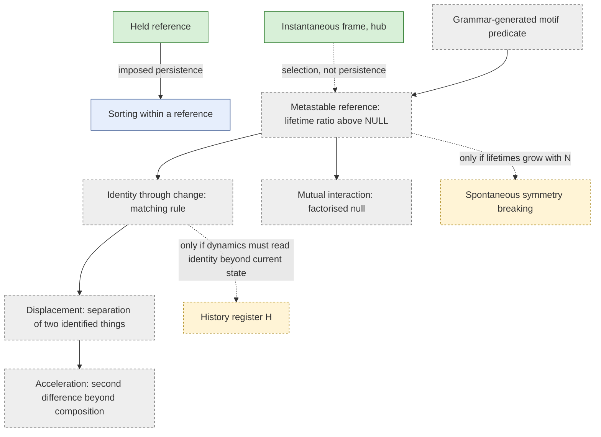

# Reference architecture review: held, selected, maintained, identified (GT-P008)

*GT-P008, Workstream B, deliverable 4. Written 2026-10-15.*
- *An architectural inquiry, not an ontology extension. It adds no primitive, axis or rule, and runs no experiment.*
- *Layers: [M] marked propositions with proofs; [O] references to published findings; [RS] marked interpretation. [P] none. [T] none.*

## 0. Why this review

- Every GT basin, gathering and sorting result so far is measured **relative to a held reference** H: a set of relations prohibited from dissolving (charter §3).
- E3 and E4 showed that H is not a neutral ruler.
  - Its internal relations witness the attachment slots (F1).
  - It tilts the first-order witness environment through held degree (derivation S4).
  - It sorts where new relations form (GT-F60).
- Before more scaffold rounds, we need to know what it would take to **replace an imposed reference with one the dynamics maintains**, and which missing capabilities need new machinery rather than better definitions.

## 1. Four reference regimes

| | 1. Externally held | 2. Instantaneously selected / conditioned | 3. Dynamically maintained (metastable) | 4. Identifiable through change |
| --- | --- | --- | --- | --- |
| **Definition** | H present with dissolution prohibited (`gt0.Scaffold`) | A frame chosen from the current FREE state: max-degree hub, a motif instance, a conditioning event | A structure persisting over a declared interval through endogenous transitions, every relation free to change | A pattern tracked across reconfiguration by a declared, non-circular matching rule, possibly in the quotient under relabelling |
| **Where persistence comes from** | Imposed: infinite lifetime by fiat | None claimed: a fresh frame at each instant | The dynamics: lifetime finite but long relative to declared clocks | The dynamics, *and* a criterion of sameness |
| **Symmetry** | Breaks S_N to the stabiliser of H; source labels are meaningful | S_N-covariant if the selection rule is; ties need a rule | The stationary law is S_N-invariant (R1); persistence is a trajectory property | The same; identity must not use labels as a shortcut (§3.3) |
| **Observable conditions** | Source and probe classes defined by H | Frame-relative statistics at the moment of selection | Lifetime and recurrence distributions of a motif predicate; autocorrelation of frame identity; both clocks | The above, plus a survival function of identity, and split, merge and reappearance rates |
| **Existing GT evidence** | All HELD rounds (G0–E4) | GT-F28 (hub frame makes the FREE arrow legible), GT-F29 | GT-F22 (no emergent centre in E0A FREE: degree heterogeneity ≤ NULL); GT-F23 (localisation persistence index τ(degree)/τ(edges) > 1 only in sparse cells, at most 2.2) | None |
| **Main risk** | Mistaking the scaffold's own structure for the rules' tendency (E3B, E4) | **False emergence:** a selected hub has high degree by construction, so attachment to it is selection, not tendency | Calling any long autocorrelation a reference; thresholds tuned after viewing | Circular identity rules that encode the result (for example, "the reference is wherever attachment is highest") |
| **Value** | Clean boundary condition; exact small-N laws; the comparisons of E1–E4 | Makes source-relative patterns visible without imposing H (GT-F28) | The first regime in which "the system made its own reference" could even be asked | Needed for anything that moves *relative to* something (displacement) |

These are **distinct architectures, not points on one scale**. In particular:
- a selected frame (2) does not become maintained (3) by being re-selected at every instant;
- a maintained structure (3) does not become identifiable (4) without a matching rule.

## 2. What finite label-covariant models allow (propositions)

**R1 (proposition: exchangeability).** In FREE mode with label-covariant rules and an irreducible reachable class, the unique stationary law π (in either clock) is invariant under every vertex permutation. So every vertex has identical stationary statistics.
- *Proof.* A permutation σ maps the rates to themselves (covariance), so π∘σ is stationary. Uniqueness gives π∘σ = π. ∎

**R2 (proposition: no labelled centre in the long run).** Under the hypotheses of R1, take any label-covariant observable g(x, v), for example "v has maximal degree, with ties split equally". Its long-run time average along almost every trajectory equals E_π[g(x, v)], the same for every v. So no labelled vertex is "the centre" in the long run.
- *Proof.* The ergodic theorem for finite irreducible chains, then R1. ∎

**R3 (proposition: three routes to unbounded persistence of a labelled structure).** In a finite model, a labelled structure can persist for unbounded time only if one of the following holds:
- **(a)** it is imposed (regime 1);
- **(b)** irreducibility fails, because hard prohibitions create several closed classes or absorbing states. The class reached then depends on the initial condition or on early history. S_N permutes these classes, so the selected structure is a **frozen-in** choice, not a dynamically preferred one;
- **(c)** a limit is taken (N → ∞, or a factor → 0 or ∞) in which lifetimes diverge: metastability becoming spontaneous symmetry breaking.
- *Proof sketch.* Outside (a) and (b), R2 applies at every finite parameter. (c) is the only remaining way for a persistence time to exceed every finite bound. ∎
- *Known GT instance of (b):* LOCK absorbs into the complete graph (GT-F06), which is symmetric, so no reference is selected.

**Consequences for any FREE study:**
1. A **dynamically maintained reference** at finite N is necessarily **metastable**. The scientific quantity is a *ratio of time scales*: the lifetime of the structure against the turnover of the relations composing it and against the mixing time. It is not a yes/no.
2. A **spontaneous symmetry-breaking claim** needs evidence that this ratio grows with N, or with strength, at fixed rules. Finite-N exact laws can show growth trends only. **No GT result bears on this yet.**
3. A **trajectory-conditioned frame**, "the hub at time t", is legitimate for observation. But its statistics at time t inherit the selection: high degree by definition. Any measured tendency must be separated from the selection by a **time lag** (select at t, measure at t + Δ) or by a selection predicate disjoint from the measured quantity.

## 3. Minimum definitions, and the tests that discriminate them

### 3.1 Existence and recognition

- **What counts as a source-like motif.** A predicate P on (vertex set A, current state x) that is label-covariant: P(σA, σx) = P(A, x).
- **Candidates generated by the grammar**, not the analyst:
  - closed motifs the rules favour (triangles under closure families, GT-F05);
  - the motifs on which path rules act (two-paths);
  - stars, which E4 showed are sorted internally.
- **Analyst-induced and arbitrary:** "the top-k degree set", or any threshold chosen after viewing.
- **Discriminating test.** Compare the motif's stationary frequency and lifetime with NULL at matched density: the composition lesson of GT-F62, applied to motifs.

### 3.2 Persistence

- **Quantities.** For a predicate P, measured in both clocks:
  - the lifetime of an instance: first passage from "P holds on A" to "P fails on A";
  - the recurrence time on the same A;
  - the survival through partial replacement: P holds throughout while some constituent relations have toggled;
  - the lifetime ratio Λ = lifetime / mean turnover time of a constituent relation.
- **Thresholds, declared before viewing:**
  - Λ > 1 is the minimum for "maintained beyond its parts";
  - a declared multiple of NULL's Λ at matched density;
  - stability of Λ's rank across N = 5 and 6.
- **Finite-state caveat.** Every lifetime is finite (R2). With exact small-N laws, lifetimes are mean first-passage times, computable from the generator without sampling.

### 3.3 Identity through change

**The labelled shortcut.**
- With labelled vertices and single toggles, "the same A" is trivially decidable. But it makes identity depend on analyst labels, which R1 renders exchangeable.
- That is acceptable for *instance* persistence ("this vertex set kept its motif"). It is not acceptable for claims about *a structure that moves*, which by definition changes its vertex set.

**A non-circular matching rule (one candidate among several).**
- Instance A_t at event t continues as A_(t+1) if P(A_(t+1), x_(t+1)) holds and |A_t ∩ A_(t+1)| ≥ m, with m declared (for example, all but one vertex).
- **Ties:** several qualifying successors means a split; record every branch.
- **Merges:** two predecessors with one successor.
- **Extinction:** no qualifying successor.
- **Reappearance:** a new instance overlapping an extinct one within a declared window. It is reported separately and never relabelled as continuation.

**Is a history register needed?**
- **For tracking: no.** Identity is an *observable on trajectories*, computed from (x_t, x_(t+1)) pairs. The dynamics never reads it, so no ontology axis is involved.
- **For dynamics that respond to identity: only then.** A history register H > 0 becomes a real question only if the rules must respond differently to "the reference" in ways that are *not a function of the full current state*.
  - If they are a function of current state, the 8G gate applies: compile by increasing K or J (CL-T12). The rules would read motif membership, a representation trade-off rather than new expressivity.
  - If they are not, the laboratory's **same-full-current-state history witness** (CL `formal/open-problems.md`, History H) is the test to run *first*.
  - GT has no candidate for either. **No H > 0 recommendation follows.**

### 3.4 Relative frame and separation

- **Distance to a changing reference.** Use the shortest-path distance from a probe to the current instance's vertex set (an existing derived observable, charter §3).
- **Avoiding circularity:**
  - define the reference by P alone;
  - measure attachment or distance at a **lag**;
  - compare against a **relabelled baseline** (the same statistics for a randomly chosen vertex set of equal size and density), so that selection effects cancel.
- **The danger case.** "Probes are closer to the hub" is guaranteed by the definition of a hub. GT-F28's hub-frame *asymmetry* is a legitimate finding because it compares event orders, not distances, and reversible controls give zero (Y5).

### 3.5 Symmetry and labels: four different claims

| Claim | What would show it | What does not |
| --- | --- | --- |
| A labelled persistent centre | Only imposition (R3a) or frozen-in selection (R3b) at finite N | Any FREE stationary statistic (R1, R2) |
| A symmetry-invariant motif | A motif predicate whose frequency or lifetime differs from NULL at matched density | High instantaneous degree of some vertex |
| A trajectory-conditioned frame | Frame-relative statistics with lag and relabelled baselines | Unlagged frame statistics |
| Spontaneous symmetry breaking | A lifetime ratio Λ that grows with N (or strength) at fixed rules | Any single-N result |

### 3.6 Clocks

- Persistence and recovery are clock-dependent in GT (GT-F20, triad clock reversal; derivation S6, where PCOMP sorts per event only).
- Every lifetime must be reported in **both** clocks: per event and per unit time.
- A structure can be long-lived per event while short-lived per unit time, if its neighbourhood is slow.

### 3.7 Support against propensity

- Hard gates (support), soft kinetics (propensity), conditional occupancy and persistence are four different things (E2, E3).
- None of them is motion. A motif that persists because its dissolution is gated (one-way release, GT-F51) is **arrested**, not anchored by attraction.

### 3.8 Mutual interaction

For two persistent endogenous structures A and B, "A influences B" would mean that B's lifetime, attachment profile or position statistics depend on A's presence or separation, **compared with the product of their single-structure statistics** at matched density. This needs:
- both structures metastable (3.2);
- both identifiable (3.3);
- a separation observable (3.4);
- a factorised null.

It is distinct from the analyst holding one structure fixed: with a held structure, B's statistics conditional on H are a single-reference result. **GT has no two-structure result.**

### 3.9 Operational displacement

- **Definition.** Displacement of a tracked object O relative to a reference R is a change in a separation observable s(O_t, R_t), with O and R identified by declared matching rules.
- **Logically required:** two identities and one separation.
- **Not required:** a metric space, coordinates or a continuum. Graph distance is a separation, not a metric of space.
- **Acceleration** would need at least a well-defined drift of s, and a second difference that is not an artefact of density composition or frame selection.

**Renaming an attachment gradient or a density gradient as acceleration is excluded.**

### 3.10 Compilation and the ontology gate (8G)

| Candidate machinery | Where it lives | 8G status |
| --- | --- | --- |
| Motif predicate, lifetime, matching rule | Observables on trajectories | No ontology question: the analysis reads them, the dynamics does not |
| Rules that act on motif members (for example, slow dissolution inside a motif) | Current-state rules with larger K or J | **Compilable** in principle (CL-T12). A representation trade-off: K and J grow. Must stay label-covariant (the motif predicate, not names) |
| Rules that remember which instance was "the reference" | H > 0 | Only after a same-full-current-state witness shows that the current state cannot carry it |
| A persistent attribute such as "mass" | A new axis | **Not recommended.** No expressivity question has been posed that the existing grammar fails |

## 4. Prerequisite map

**Categories:**
- **Logically required:** within the operational definition.
- **Potentially sufficient:** under stated assumptions.
- **Candidate:** one implementation among several.
- **Speculative [RS].**
- **Unknown / possibly unnecessary.**
- **Blocked:** by current data or architecture.

| Target | Prerequisite | Category | Present status |
| --- | --- | --- | --- |
| Emergent reference (regime 3) | Motif predicate generated by the grammar | Logically required | Candidates exist (triangles, stars); no FREE study |
| | Lifetime ratio Λ > 1 against NULL at matched density | Logically required | Not measured. GT-F23's index is a crude proxy (≤ 2.2) |
| | Λ growing with N | Required for a symmetry-breaking claim; not for metastability | **Blocked:** N ≤ 6 exact; N = 7 not authorised |
| Identifiable reference (regime 4) | Matching rule (3.3) | Logically required | Definable now; not implemented |
| | History register | Unknown / possibly unnecessary | Tracking needs none (3.3) |
| Displacement | Two identities plus a separation | Logically required | Separation exists (graph distance); identities are not defined |
| | A metric space | Not required | — |
| Acceleration | Drift of the separation, and its second difference beyond composition | Logically required | **Blocked** by the above |
| Mutual interaction | Two metastable, identifiable structures; a factorised null | Logically required | No candidate structures |
| Gravity-like attraction | Any of the above, *plus* density-independent preference | Speculative [RS] | E4: native gathering is mostly composition (GT-F62) |
| Sorting within a reference | Held reference | Potentially sufficient (observed) | Robust under held references (GT-F60); undetermined for emergent references |

## 5. What can and cannot be inferred now

**Can:**
- Held references sort attachment (GT-F60), and that sorting has an exact local lever plus a global residue (derivation S2).
- FREE models cannot have a labelled persistent centre at finite N (R1–R3).
- Instantaneous frames make some patterns legible (GT-F28).

**Cannot:**
- that any GT rule set generates a metastable reference;
- that sorting survives when the reference is not held;
- that anything is displaced;
- that two structures interact;
- that held-reference results transfer to emergent references. The held reference's floor, held degree and infinite lifetime are all part of what was measured.

**First missing piece: a definition, not a mechanism.** The first missing capability is a declared motif predicate with a lifetime ratio against NULL, in both clocks. That needs no new machinery: it is an observable layer on existing FREE chains. Identity through change and displacement come after it.

## 6. Interpretation, kept separate [RS]

- In relational terms, a "reference" that is simply imposed tells us how relations arrange themselves around a fixed structure. It does not tell us whether relational dynamics can make a structure that is *there* in a self-maintaining sense.
- In this grammar, the latter is a question of time scales (metastability), not of special entities. Exchangeability (R1) forbids privileged labels, which fits relational primacy: whatever persists must be a pattern, not a thing with a name.
- This is an interpretation of the model's logic, not a claim about physics.
