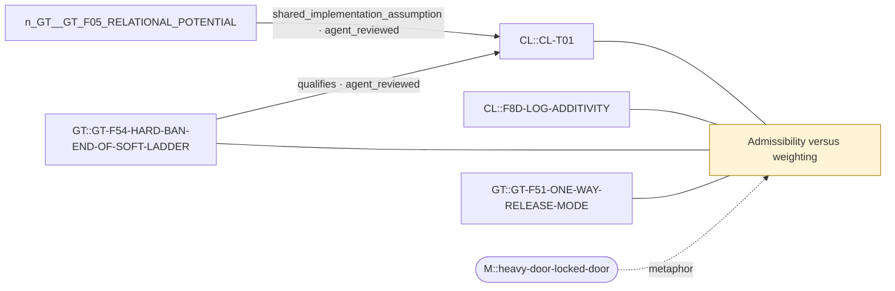

# Theme: Admissibility versus weighting

`C::admissibility-vs-weighting` (theme, working_definition)

**Definition.** Hard constraints change which transitions exist (support, reachable class, one-way transitions); soft constraints change positive rates. Zero lies outside the multiplicative/log-additive weight algebra, yet some stationary observables can be continuous along a ladder of soft factors ending at a hard ban.

**In plain words.** Forbidding something is different in kind from merely making it rare, even when the results sometimes look similar.

## Anchoring findings (pinned sources)

- `CL::CL-T01` [formal_claim, FORMAL_ALGEBRAIC_THEOREM, ALGEBRAIC_THEOREM]: Matching fixed rules multiply event weights; their logarithms add.
- `CL::F8D-LOG-ADDITIVITY` [source_finding, OBSERVATION, active]: On every one of the 3584 weighted two-rule systems, the implementation kernel weights equal the product of the two rules' multipliers on all 1024 states as exact fractions. The combined log weight minus the sum of the t…
- `GT::GT-F54-HARD-BAN-END-OF-SOFT-LADDER` [source_finding, OBSERVATION, active]: Along path-formation factors 1/2, 1/4, 1/9, 1/16 and 0 (existing W4/W3/W16 grades and prohibit) the partner index (FREE N=5: 0.072, 0.104, 0.112, 0.111, 0.108), flux (0.11, 0.18, 0.21, 0.22, 0.23) and absence duration o…
- `GT::GT-F51-ONE-WAY-RELEASE-MODE` [source_finding, OBSERVATION, active]: Hard path-form exclusion produces a directed mode of succession without cycle affinity: no intact square carries affinity, irreversibility is carried by one-way transitions that are all releases (re-formation forbidden …

## Connections touching this theme

- X::0005 shared_implementation_assumption (AGENT-REVIEWED (awaiting human acceptance)): `GT::GT-F05-RELATIONAL-POTENTIAL` → `CL::CL-T01`
- X::0006 qualifies (AGENT-REVIEWED (awaiting human acceptance)): `GT::GT-F54-HARD-BAN-END-OF-SOFT-LADDER` → `CL::CL-T01`

## Questions

- none

## Metaphors (non-evidentiary)

- `M::heavy-door-locked-door`

