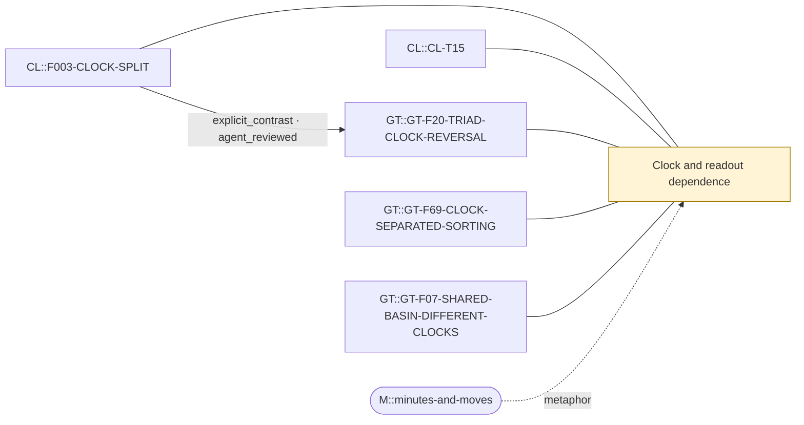

# Theme: Clock and readout dependence

`C::clock-readout-dependence` (theme, working_definition)

**Definition.** A conclusion about a stochastic relational process can change with the time parameterisation (continuous time vs jump/event count vs an epoch counting only some event types) and with the projection used to read it out. The clock is part of the estimand.

**In plain words.** What you see depends on how you count time and what you choose to watch.

## Anchoring findings (pinned sources)

- `CL::F003-CLOCK-SPLIT` [source_finding, OBSERVATION, active]: Separating the full-event clock from the pair-event epoch shows that some apparent pairwise memory is hidden timing and some is a hidden transition law. On the pair-event clock the next pair event can still depend on th…
- `CL::CL-T15` [formal_claim, FORMAL_ALGEBRAIC_THEOREM, ALGEBRAIC_THEOREM]: If P=T+B and rho(T)<1, E=(I-T)^-1 B; full-event stationary pi induces epoch stationary rho proportional to pi B.
- `GT::GT-F20-TRIAD-CLOCK-REVERSAL` [source_finding, OBSERVATION, active]: At one shared law, CLOSE, SPLIT and HOLD relax in opposite orders under the two clocks: per mean event gaps 0.14 / 0.68 / 1.40, per unit time 2.77 / 1.87 / 0.64 (FREE N5); immediate reversal approach > split > retention…
- `GT::GT-F69-CLOCK-SEPARATED-SORTING` [source_finding, INFERENCE, active]: Theorems S2b, S5, S6: PCOMP's continuous-time law is uniform at any strength (no continuous sorting despite a floor) while its per-event law sorts (published +0.08 to +0.18 log odds); equal-ratio pairs (PATHF ws, PATHH …
- `GT::GT-F07-SHARED-BASIN-DIFFERENT-CLOCKS` [source_finding, OBSERVATION, active]: CLOSE(m) and HOLD(1/m) have identical continuous-time shell masses (gap 0) and different jump-clock shell masses (gap 0.0009 to 0.063). At one shared law their continuous-time near/far activity ratios are 0.637 and 0.03…

## Connections touching this theme

- X::0003 explicit_contrast (AGENT-REVIEWED (awaiting human acceptance)): `CL::F003-CLOCK-SPLIT` → `GT::GT-F20-TRIAD-CLOCK-REVERSAL`

## Questions

- XQ::03 (open): Can every clock dependence in both programmes be written as a random time change plus a declared projection, and which effects need the projection?

## Metaphors (non-evidentiary)

- `M::minutes-and-moves`

Diagram: [clock-readout-dependence.mmd](clock-readout-dependence.mmd)

