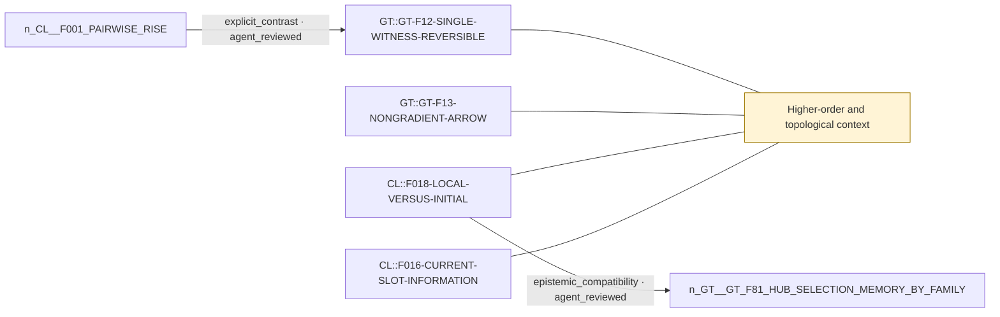

# Theme: Higher-order and topological context

`C::higher-order-context` (theme, working_definition)

**Definition.** Dependence of a lower-order event (a pair toggle) on higher-order current structure: triads, paths, witness counts or hyperedges. Distinct from history and from initial-condition memory.

**In plain words.** Whether one link changes can depend on the shape of the links around it.

## Anchoring findings (pinned sources)

- `CL::F016-CURRENT-SLOT-INFORMATION` [source_finding, OBSERVATION, active]: The current triad carries exact local next-slot information only where the rule reads triadic state. Balanced full-mask CMI is at the floor for R00, R03, and R07. It is 0.009749 nats for R01, R02, and R04, 0.010413 for …
- `CL::F018-LOCAL-VERSUS-INITIAL` [source_finding, INFERENCE, active]: Local higher-order dependence and long-lived initial-condition memory are distinct. The current triad can alter the next pair slot after the initial triad has been forgotten by the visible pair process.
- `GT::GT-F13-NONGRADIENT-ARROW` [source_finding, OBSERVATION, active]: Unsaturated two-witness PATH cells (PATHF weak_suppress, PATHH weak_favour) carry a stationary arrow: 9-16% of stationary flux is irreversible, entropy production 0.037-0.074 nats per mean event, projected net current 3…
- `GT::GT-F12-SINGLE-WITNESS-REVERSIBLE` [source_finding, INFERENCE, active]: Every label-covariant single-witness template composition on the O=2 pair grammar (form or dissolve, any sign, hard formation exclusion, HELD scaffold) is reversible with a triple-local Gibbs law exp(theta.(E,W,T)); ver…

## Connections touching this theme

- X::0004 explicit_contrast (AGENT-REVIEWED (awaiting human acceptance)): `CL::F001-PAIRWISE-RISE` → `GT::GT-F12-SINGLE-WITNESS-REVERSIBLE`
- X::0007 epistemic_compatibility (AGENT-REVIEWED (awaiting human acceptance)): `CL::F018-LOCAL-VERSUS-INITIAL` → `GT::GT-F81-HUB-SELECTION-MEMORY-BY-FAMILY`

## Questions

- none

## Metaphors (non-evidentiary)

- none (see metaphor-gaps.md)

