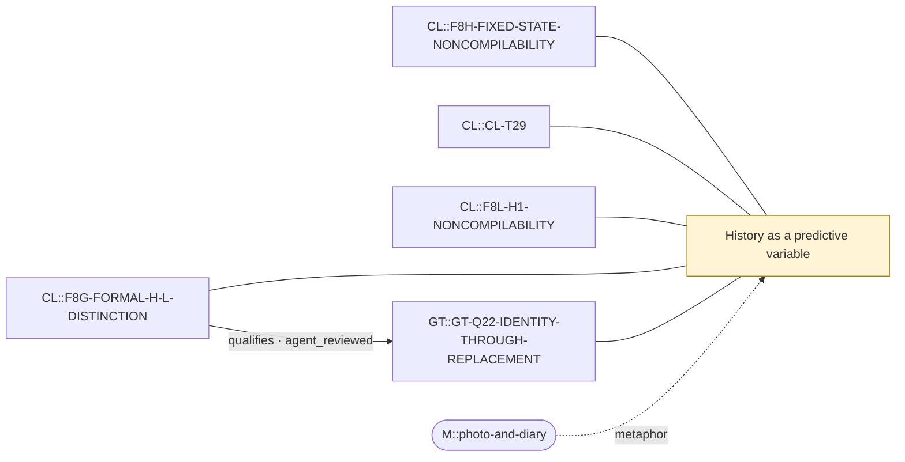

# Theme: History as a predictive variable

`C::history-as-predictive-variable` (theme, working_definition)

**Definition.** Whether some record of past events must be added to the current state to predict the future (Markov sufficiency on an augmented state), as distinct from history merely being informative about the past. Includes the compilation question: can a fixed current-state kernel reproduce the history-conditioned law?

**In plain words.** Sometimes the present snapshot is enough to predict what comes next; sometimes you also need to know how you got here.

## Anchoring findings (pinned sources)

- `CL::F8H-FIXED-STATE-NONCOMPILABILITY` [source_finding, INFERENCE, active]: No fixed first-order H0 kernel on unchanged complete ordinary x can reproduce every history-conditioned row for non-neutral m; a single row cannot equal the two verified unequal rows.
- `CL::CL-T29` [formal_claim, FORMAL_ALGEBRAIC_THEOREM, ALGEBRAIC_THEOREM]: RECENT-REVERSAL is first-order Markov on the finite augmented state (x,h).
- `CL::F8L-H1-NONCOMPILABILITY` [source_finding, INFERENCE, active]: No fixed first-order kernel on exactly (X,last-pair h1) can reproduce all conditioned SECOND-RECENT rows non-neutrally, independent of positive K/J. Hidden recoding, phase, enlarged alphabet and changed support/clock ar…
- `CL::F8G-FORMAL-H-L-DISTINCTION` [source_finding, METHODOLOGICAL, active]: H asks for different reachable histories at identical complete ordinary material state; L asks for different reachable dynamic constraint states under a common program. Neither capability has been executed here. Finite …
- `GT::GT-Q22-IDENTITY-THROUGH-REPLACEMENT` [source_question, OPEN_QUESTION, unresolved]: Does any anchored flexible organisation ever complete replacement of all its entry partners within one episode, and how often, as a trajectory observable (no history state)?

## Connections touching this theme

- X::0008 qualifies (AGENT-REVIEWED (awaiting human acceptance)): `CL::F8G-FORMAL-H-L-DISTINCTION` → `GT::GT-Q22-IDENTITY-THROUGH-REPLACEMENT`

## Questions

- XQ::04 (open): Can identity through replacement be defined as a trajectory observable that never engages a history axis, and does it distinguish GT's flexible organisations from flicker?

## Metaphors (non-evidentiary)

- `M::photo-and-diary`

Diagram: [history-as-predictive-variable.mmd](history-as-predictive-variable.mmd)

