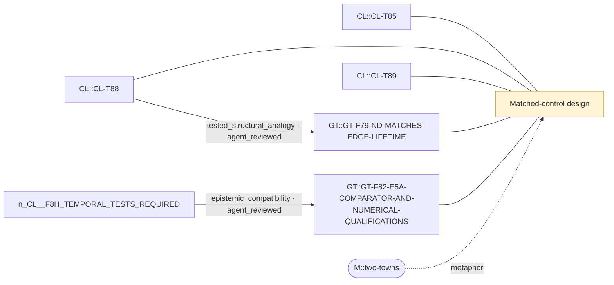

# Theme: Matched-control design

`C::matched-control-design` (formal_notion, working_definition)

**Definition.** A comparison process declared before results that matches a target on stated quantities (occupancy, density, mean rate, adjacent laws) so that remaining differences are attributable to what is not matched. Matching a quantity also fixes everything that quantity determines (e.g. Kac recurrence, CT edge lifetime).

**In plain words.** A fair comparison keeps chosen things equal on purpose, and you must know what else that silently keeps equal.

## Anchoring findings (pinned sources)

- `CL::CL-T85` [formal_claim, FORMAL_ALGEBRAIC_THEOREM, ALGEBRAIC_THEOREM]: Positive stationary H2 law and its stationary-conditional Kpi-H1 have equal class-conditioned source pushforward on (P,h1), equal material occupancy and equal class-conditioned first-event material laws.
- `CL::CL-T88` [formal_claim, FORMAL_ALGEBRAIC_THEOREM, ALGEBRAIC_THEOREM]: For a finite irreducible stationary chain, starting from its stationary conditional law on nonempty D gives E[tau_D^+]=1/pi(D). Equal class occupancy therefore forces equal same-class mean positive recurrence, not cross…
- `CL::CL-T89` [formal_claim, FORMAL_ALGEBRAIC_THEOREM, ALGEBRAIC_THEOREM]: If H2 and Kpi have unequal passage under the declared matched source law, no fixed first-order kernel on exactly (P,h1) matching the full stationary adjacent H1 law reproduces both that law and the H2 passage functional.
- `GT::GT-F79-ND-MATCHES-EDGE-LIFETIME` [source_finding, INFERENCE, active]: Post hoc identity: by exchangeability E_pi[q] = 2M J_edge, so at matched density the ND mean-rate calibration forces ND's CT edge present-lifetime to equal the target's (verified on 12 laws within 7e-15). ND differs fro…
- `GT::GT-F82-E5A-COMPARATOR-AND-NUMERICAL-QUALIFICATIONS` [source_finding, METHODOLOGICAL, active]: E5A executed 12/12 items, 32/34 frozen checks hold; two CT lag-propagator checks failed (recorded, not repaired). ND controls density and average edge lifetime but not the arrangement of activity; JT contrasts against N…

## Connections touching this theme

- X::0002 epistemic_compatibility (AGENT-REVIEWED (awaiting human acceptance)): `CL::F8H-TEMPORAL-TESTS-REQUIRED` → `GT::GT-F82-E5A-COMPARATOR-AND-NUMERICAL-QUALIFICATIONS`
- X::0009 tested_structural_analogy (AGENT-REVIEWED (awaiting human acceptance)): `CL::CL-T88` → `GT::GT-F79-ND-MATCHES-EDGE-LIFETIME`

## Questions

- XQ::01 (open): Which declared comparison process separates organisation (or history) from kinetics in both programmes, and does each programme's design transfer to the other?

## Metaphors (non-evidentiary)

- `M::two-towns`

