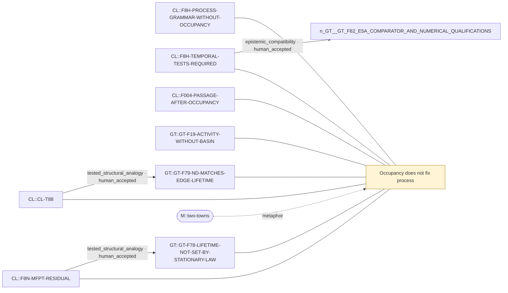

# Theme: Occupancy does not fix process

`C::occupancy-vs-process` (theme, working_definition)

**Definition.** Two finite Markov processes can share a one-time stationary law (or a matched stationary occupancy) yet differ in multi-time statistics: passage and first-passage times, episode lifetimes, two-step laws or order. Quantities fixed by the stationary law alone (e.g. Kac set recurrence 1/pi(D)) cannot discriminate them.

**In plain words.** Knowing how often something is the case does not tell you how long it lasts or how it gets there.

## Anchoring findings (pinned sources)

- `CL::F8H-PROCESS-GRAMMAR-WITHOUT-OCCUPANCY` [source_finding, INFERENCE, active]: History can alter process grammar without altering one-time stationary material structure. Here both occupancy and stationary one-step pair transitions match H0 while two-step statistics differ.
- `CL::F8H-TEMPORAL-TESTS-REQUIRED` [source_finding, METHODOLOGICAL, active]: Static occupancy alone is insufficient to test history. Future H studies require multi-time statistics, conditional process tests and lumpability/Markov-order checks with explicit clock and projection.
- `CL::F004-PASSAGE-AFTER-OCCUPANCY` [source_finding, OBSERVATION, active]: After source occupancy is separated from future dynamics, N=4 higher-order state still changes lower-order passage. On a typical T->P row most of the stationary eventual delta is occupancy. The controlled eventual remai…
- `CL::F8N-MFPT-RESIDUAL` [source_finding, OBSERVATION, active]: All 720 non-neutral ordered sibling MFPTs differ exactly: 446 slower and 274 faster under H2, with identical source/target occupancy, clock and same-class Kac recurrence.
- `CL::CL-T88` [formal_claim, FORMAL_ALGEBRAIC_THEOREM, ALGEBRAIC_THEOREM]: For a finite irreducible stationary chain, starting from its stationary conditional law on nonempty D gives E[tau_D^+]=1/pi(D). Equal class occupancy therefore forces equal same-class mean positive recurrence, not cross…
- `GT::GT-F19-ACTIVITY-WITHOUT-BASIN` [source_finding, OBSERVATION, active]: COMPETE (closure-supported formation and dissolution both favoured) has a stationary law identical to NULL (L1 <= 7e-14) yet near-source activity 4.7-5.3x far (continuous) and 1.8-2.4x (jump), doubled immediate reversal…
- `GT::GT-F78-LIFETIME-NOT-SET-BY-STATIONARY-LAW` [source_finding, OBSERVATION, active]: PCOMP and NULL share the stationary law (checked within 1e-9) and PCOMP's ND equals NULL kinetics scaled by c (44 at N=5, 4,609 at N=6), matching density, mean rate and edge lifetime; yet PCOMP flexible lifetimes are x1…
- `GT::GT-F79-ND-MATCHES-EDGE-LIFETIME` [source_finding, INFERENCE, active]: Post hoc identity: by exchangeability E_pi[q] = 2M J_edge, so at matched density the ND mean-rate calibration forces ND's CT edge present-lifetime to equal the target's (verified on 12 laws within 7e-15). ND differs fro…

## Connections touching this theme

- X::0001 tested_structural_analogy (HUMAN-ACCEPTED (at the stated decision category)): `CL::F8N-MFPT-RESIDUAL` → `GT::GT-F78-LIFETIME-NOT-SET-BY-STATIONARY-LAW`
- X::0002 epistemic_compatibility (HUMAN-ACCEPTED (at the stated decision category)): `CL::F8H-TEMPORAL-TESTS-REQUIRED` → `GT::GT-F82-E5A-COMPARATOR-AND-NUMERICAL-QUALIFICATIONS`
- X::0009 tested_structural_analogy (HUMAN-ACCEPTED (at the stated decision category)): `CL::CL-T88` → `GT::GT-F79-ND-MATCHES-EDGE-LIFETIME`

## Questions

- XQ::07 (open): Is there a common mathematical operator behind CL's predictive sufficiency and GT's persistence, or only a common question?

## Metaphors (non-evidentiary)

- `M::two-towns`

Diagram: [occupancy-vs-process.mmd](occupancy-vs-process.mmd)

