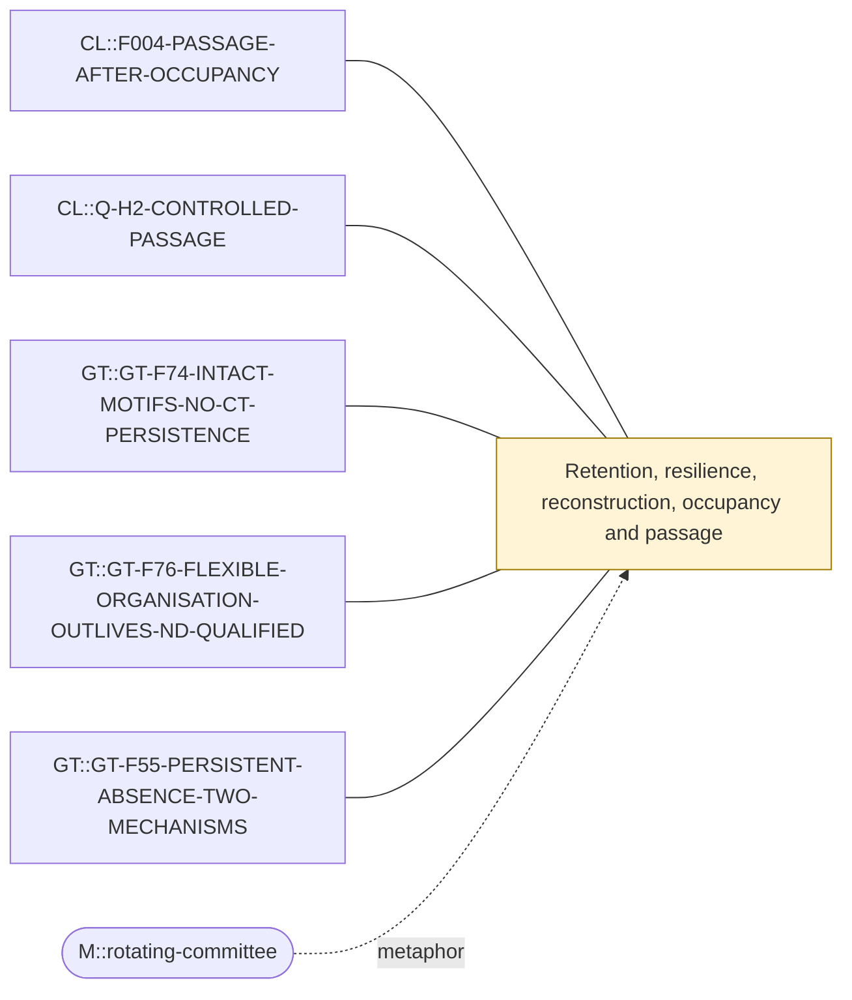

# Theme: Retention, resilience, reconstruction, occupancy and passage

`C::passage-and-persistence` (theme, working_definition)

**Definition.** Five distinct estimands that are easily conflated: occupancy (one-time stationary mass), passage (hitting/committor/first-passage between declared sets), retention (survival of a configuration or memory), resilience (return after perturbation) and reconstruction (recovery of a configuration after loss). Each needs its own declared source law, clock and control.

**In plain words.** How common something is, how you reach it, how long it lasts, whether it bounces back and whether it can be rebuilt are five different questions.

## Anchoring findings (pinned sources)

- `CL::F004-PASSAGE-AFTER-OCCUPANCY` [source_finding, OBSERVATION, active]: After source occupancy is separated from future dynamics, N=4 higher-order state still changes lower-order passage. On a typical T->P row most of the stationary eventual delta is occupancy. The controlled eventual remai…
- `CL::Q-H2-CONTROLLED-PASSAGE` [source_question, OPEN_QUESTION, qualified]: Under independently declared source/target, matched occupancy, unchanged support/clock and hitting estimands, which ordered H2 roles alter controlled passage beyond the specified H1 controls?
- `GT::GT-F74-INTACT-MOTIFS-NO-CT-PERSISTENCE` [source_finding, OBSERVATION, active]: Intact motifs (I_TRI, I_STAR, I_2PATH) outlive the density-matched comparator ND in continuous time in 1/30 non-NULL rows (PATHH star, x1.004 at N=5, x1.093 at N=6); jump-clock lengths exceed ND in 22/30 but ND is not j…
- `GT::GT-F76-FLEXIBLE-ORGANISATION-OUTLIVES-ND-QUALIFIED` [source_finding, OBSERVATION, qualified]: Flexible anchored organisations (F_TRI, F_STAR, F_2PATH) outlive ND in both clocks in 18/30 rows (CLOSEW 6, PCOMP 5, PATHF 4, CSPH 3), in jump time only in 10 (PATHH 6, CSPH 3, PCOMP 1), and not in 2 (PATHF F_TRI); with…
- `GT::GT-F55-PERSISTENT-ABSENCE-TWO-MECHANISMS` [source_finding, OBSERVATION, active]: A relation released while path-witnessed stays absent longer than one released unwitnessed in every path-suppressing cell (hard FREE N=5: 3.40 vs 2.50 time units; soft 1/16: 3.27 vs 2.43; NULL: equal, 1.00). Two mechani…

## Connections touching this theme

- none

## Questions

- XQ::01 (open): Which declared comparison process separates organisation (or history) from kinetics in both programmes, and does each programme's design transfer to the other?
- XQ::07 (open): Is there a common mathematical operator behind CL's predictive sufficiency and GT's persistence, or only a common question?

## Metaphors (non-evidentiary)

- `M::rotating-committee`

Diagram: [passage-and-persistence.mmd](passage-and-persistence.mmd)

