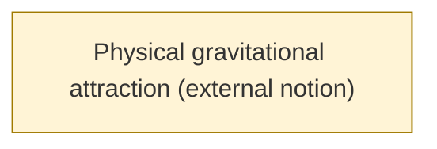

# Theme: Physical gravitational attraction (external notion)

`C::physical-attraction` (external_notion, working_definition)

**Definition.** Gravitational attraction as understood in physics. Not a model object in any programme here. It is named only so that tempting but unsupported bridges (false attractors) can be recorded and rejected.

**In plain words.** Gravity as physicists mean it, which none of these models derives.

## Anchoring findings (pinned sources)

## Connections touching this theme

- none

## Questions

- none

## Metaphors (non-evidentiary)

- none (see metaphor-gaps.md)

Diagram: [physical-attraction.mmd](physical-attraction.mmd)

