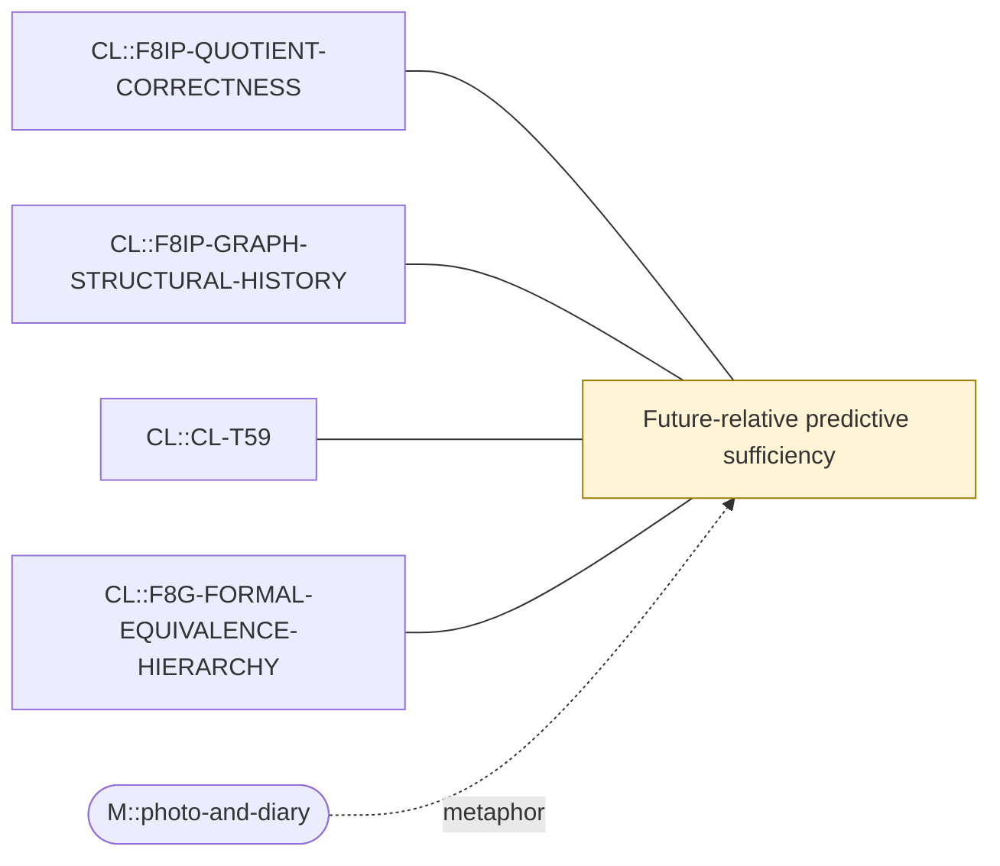

# Theme: Future-relative predictive sufficiency

`C::predictive-sufficiency` (formal_notion, working_definition)

**Definition.** A state description (or quotient of it) is predictively sufficient for a declared observable and horizon if conditioning on it renders further past information irrelevant to that observable's future law. Valid dynamical quotients must commute with the kernel (strong lumpability).

**In plain words.** A summary is good enough when adding more detail about the present or past would not improve your forecast of the thing you care about.

## Anchoring findings (pinned sources)

- `CL::F8IP-QUOTIENT-CORRECTNESS` [source_finding, OBSERVATION, active]: Transforming graph and remembered pair together gives a valid dynamical quotient. All nine adjacent predictive-ladder arrows are deterministic strong lumpings and match direct kernels and stationary pushforwards exactly.
- `CL::F8IP-GRAPH-STRUCTURAL-HISTORY` [source_finding, INFERENCE, active]: For graph-class prediction the sufficient and necessary remembered datum is the automorphism orbit of the last pair in the current graph, not its absolute labelled identity.
- `CL::CL-T59` [formal_claim, FORMAL_ALGEBRAIC_THEOREM, ALGEBRAIC_THEOREM]: The non-neutral 384->28->12->2 and neutral 64->11->7->2 predictive ladders are nested deterministic strong lumpings whose kernels and stationary pushforwards commute.
- `CL::F8G-FORMAL-EQUIVALENCE-HIERARCHY` [source_finding, METHODOLOGICAL, active]: Canonical syntax, weights, full local law, full kernel, conjugacy, projected process and statistic equality are distinct. Valid dynamical quotients must preserve the whole law; visible graph isomorphism alone is insuffi…

## Connections touching this theme

- none

## Questions

- XQ::07 (open): Is there a common mathematical operator behind CL's predictive sufficiency and GT's persistence, or only a common question?

## Metaphors (non-evidentiary)

- `M::photo-and-diary`

