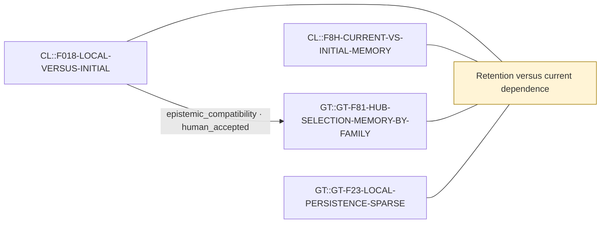

# Theme: Retention versus current dependence

`C::retention-vs-current-dependence` (theme, working_definition)

**Definition.** Long-lived memory of an initial condition or past selection (retention, which decays in an irreducible chain) is distinct from exact dependence of the next event on current structure.

**In plain words.** Forgetting where you started is not the same as ignoring where you are now.

## Anchoring findings (pinned sources)

- `CL::F018-LOCAL-VERSUS-INITIAL` [source_finding, INFERENCE, active]: Local higher-order dependence and long-lived initial-condition memory are distinct. The current triad can alter the next pair slot after the initial triad has been forgotten by the visible pair process.
- `CL::F8H-CURRENT-VS-INITIAL-MEMORY` [source_finding, INFERENCE, active]: Current history remains efficacious at non-neutral m while initial-slot information in h decays: lambda=(m-1)/(m+5) has multiplicity five and TV=(5/6)|lambda|^k. A register does not retain its initial value forever.
- `GT::GT-F81-HUB-SELECTION-MEMORY-BY-FAMILY` [source_finding, OBSERVATION, active]: A once-selected maximum-degree vertex's advantage decays toward zero in every law; it decays more slowly than ND in both clocks under PATHF, PATHH and CSPH at both sizes (CSPH N=6 lag 16: 0.24/0.27 of the initial gap vs…
- `GT::GT-F23-LOCAL-PERSISTENCE-SPARSE` [source_finding, OBSERVATION, active]: The localisation persistence index tau(degree)/tau(edges) exceeds 1 only in sparse, triangle-poor cells (PATH suppress-sign FREE N5 2.20 and 2.07, EXCL 1.49, ANTI 1.34) and is below 1 in attractive cells (CLOSE 0.72); N…

## Connections touching this theme

- X::0007 epistemic_compatibility (HUMAN-ACCEPTED (at the stated decision category)): `CL::F018-LOCAL-VERSUS-INITIAL` → `GT::GT-F81-HUB-SELECTION-MEMORY-BY-FAMILY`

## Questions

- none

## Metaphors (non-evidentiary)

- none (see metaphor-gaps.md)

Diagram: [retention-vs-current-dependence.mmd](retention-vs-current-dependence.mmd)

