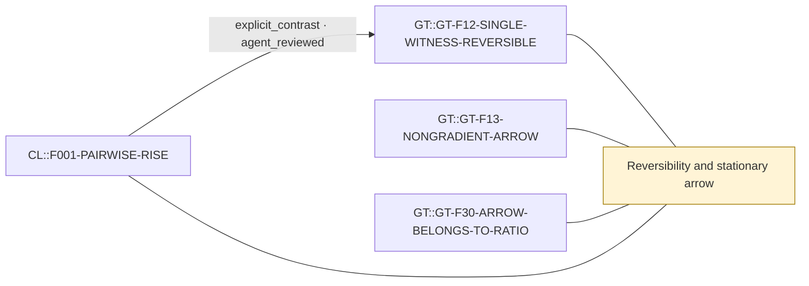

# Theme: Reversibility and stationary arrow

`C::reversibility-and-arrow` (formal_notion, working_definition)

**Definition.** A stationary chain is reversible iff detailed balance holds (no net cycle currents); a stationary arrow is net irreversible flux. Which rule classes guarantee reversibility depends on label covariance and witness structure.

**In plain words.** A process has a direction when, even in balance, it runs around some loops more one way than the other.

## Anchoring findings (pinned sources)

- `GT::GT-F12-SINGLE-WITNESS-REVERSIBLE` [source_finding, INFERENCE, active]: Every label-covariant single-witness template composition on the O=2 pair grammar (form or dissolve, any sign, hard formation exclusion, HELD scaffold) is reversible with a triple-local Gibbs law exp(theta.(E,W,T)); ver…
- `GT::GT-F13-NONGRADIENT-ARROW` [source_finding, OBSERVATION, active]: Unsaturated two-witness PATH cells (PATHF weak_suppress, PATHH weak_favour) carry a stationary arrow: 9-16% of stationary flux is irreversible, entropy production 0.037-0.074 nats per mean event, projected net current 3…
- `GT::GT-F30-ARROW-BELONGS-TO-RATIO` [source_finding, OBSERVATION, active]: PCOMP (path formation and path dissolution both favoured, non-gradient rules with ratio identically 1) is exactly reversible and uniform in every mode and N (Y1), so the arrow is a property of the rate ratio, not of the…
- `CL::F001-PAIRWISE-RISE` [source_finding, OBSERVATION, active]: In the searched memoryless pairwise cells, reweighting moves stationary triangle mass and can break reversibility, and it does not move the predeclared 4-step rise-then-release probability for the same three-literal clo…

## Connections touching this theme

- X::0004 explicit_contrast (AGENT-REVIEWED (awaiting human acceptance)): `CL::F001-PAIRWISE-RISE` → `GT::GT-F12-SINGLE-WITNESS-REVERSIBLE`

## Questions

- none

## Metaphors (non-evidentiary)

- none (see metaphor-gaps.md)

