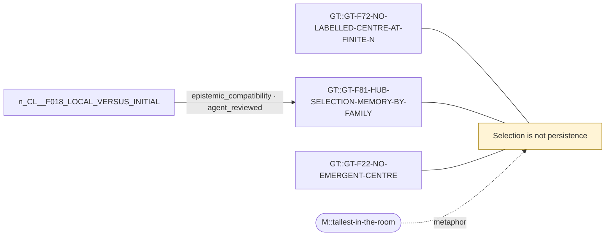

# Theme: Selection is not persistence

`C::selection-vs-persistence` (formal_notion, working_definition)

**Definition.** An object chosen by an observer for an extreme current property (e.g. the maximum-degree vertex) shows that property at selection time by construction; persistence is the decay of that advantage under the dynamics, against comparators. In finite exchangeable irreducible chains no labelled object stays distinguished.

**In plain words.** Picking the tallest person in a room does not show that tallness lasts.

## Anchoring findings (pinned sources)

- `GT::GT-F72-NO-LABELLED-CENTRE-AT-FINITE-N` [source_finding, INFERENCE, active]: Propositions R1-R3: in FREE label-covariant irreducible models the stationary law is invariant under all vertex permutations and every labelled vertex has identical long-run statistics; unbounded persistence of a labell…
- `GT::GT-F81-HUB-SELECTION-MEMORY-BY-FAMILY` [source_finding, OBSERVATION, active]: A once-selected maximum-degree vertex's advantage decays toward zero in every law; it decays more slowly than ND in both clocks under PATHF, PATHH and CSPH at both sizes (CSPH N=6 lag 16: 0.24/0.27 of the initial gap vs…
- `GT::GT-F22-NO-EMERGENT-CENTRE` [source_finding, OBSERVATION, active]: No E0A cell produced degree heterogeneity above NULL in FREE mode; FRUST (wedges rewarded, triangles cost two wedge-units) lowered degree variance (0.46 against 0.60 at N=5) and attachment (0.74 against 0.75).

## Connections touching this theme

- X::0007 epistemic_compatibility (AGENT-REVIEWED (awaiting human acceptance)): `CL::F018-LOCAL-VERSUS-INITIAL` → `GT::GT-F81-HUB-SELECTION-MEMORY-BY-FAMILY`

## Questions

- none

## Metaphors (non-evidentiary)

- `M::tallest-in-the-room`

