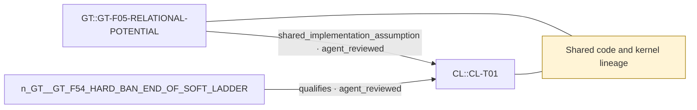

# Theme: Shared code and kernel lineage

`C::shared-lineage` (provenance_notion, working_definition)

**Definition.** GT and CL 8N both descend from CL 8G (22e252e) and share the constraint-lab DSL, kernel builder and coherence validator. Agreement on anything inherited is not independent evidence.

**In plain words.** Two reports written with the same calculator can agree because of the calculator.

## Anchoring findings (pinned sources)

- `CL::CL-T01` [formal_claim, FORMAL_ALGEBRAIC_THEOREM, ALGEBRAIC_THEOREM]: Matching fixed rules multiply event weights; their logarithms add.
- `GT::GT-F05-RELATIONAL-POTENTIAL` [source_finding, OBSERVATION, active]: For every template the continuous-time stationary law is m^S/Z with S the edge count (DENS), wedge count (ADJ) or triangle count (CLOSE, and HOLD with m replaced by 1/m), within 9e-15 at N=5 in both modes. CLOSE(m) and …

## Connections touching this theme

- X::0005 shared_implementation_assumption (AGENT-REVIEWED (awaiting human acceptance)): `GT::GT-F05-RELATIONAL-POTENTIAL` → `CL::CL-T01`
- X::0006 qualifies (AGENT-REVIEWED (awaiting human acceptance)): `GT::GT-F54-HARD-BAN-END-OF-SOFT-LADDER` → `CL::CL-T01`

## Questions

- none

## Metaphors (non-evidentiary)

- none (see metaphor-gaps.md)

Diagram: [shared-lineage.mmd](shared-lineage.mmd)

